# AccountingLab — Informe técnico y académico

**Implementación y documentación de 22 patrones de diseño**

*Aplicación de SOLID y Clean Architecture en un sistema de información contable empresarial*

| Campo | Valor |
|---|---|
| **Estudiante** | JESUS GUILLERMO ORTEGON GUTIERREZ |
| **Programa académico** | DESARROLLO DE SOFTWARE |
| **Institución** | UNINPAHU |
| **Asignatura** | PATRONES |
| **Docente** | LEONARDO VALENZUELA |
| **Año** | 2026 |

> Documento convertido a Markdown desde `Informe_Maestro_AccountingLab_2026_Unificado.docx` (versión maestra unificada, actualizada al 24 de noviembre de 2026). Los diagramas UML son modelos conceptuales: contrastar con el código definitivo del repositorio.

---


## CONTROL DEL DOCUMENTO

| Campo | Descripción |
|---|---|
| Nombre | Informe técnico y académico de AccountingLab |
| Versión | Informe maestro unificado — actualización al 24 de noviembre de 2026 |
| Fecha de elaboración | Noviembre de 2026 |
| Proyecto | AccountingLab — sistema contable empresarial |
| Tecnologías principales | C#, .NET 8, ASP.NET Core, EF Core, MySQL (Docker del proyecto: 8.4; equipo local: MySQL Server 8.0.46 reportado), MariaDB 10.4.32 en XAMPP, React, TypeScript, Docker y Swagger/OpenAPI |
| Arquitectura | Clean Architecture: Domain, Application, Infrastructure y API; frontend independiente |
| Alcance académico | 22 patrones de diseño: 5 creacionales, 7 estructurales y 10 de comportamiento |

> **Nota de integridad académica**  Este informe consolida los requisitos compartidos, la documentación previa y los avances relatados en conversaciones. Los diagramas UML incluidos para los patrones son modelos conceptuales de responsabilidades; deben cotejarse con los nombres y relaciones definitivos del repositorio antes de afirmar que son un reflejo literal del código.


## RESUMEN EJECUTIVO

AccountingLab es un laboratorio universitario de software orientado a procesos de información contable empresarial. El trabajo académico consiste en estudiar, implementar y documentar veintidós patrones de diseño del catálogo de patrones clásicos, integrándolos con una arquitectura por capas y preservando las reglas de negocio, los contratos y las pruebas del sistema.

La solución utiliza C# y .NET 8 para el backend, ASP.NET Core para exponer servicios HTTP, Entity Framework Core para el acceso a datos, MySQL como motor de persistencia (el README documenta MySQL 8.4 en Docker; en el equipo local se reportó MySQL Server 8.0.46 y MariaDB 10.4.32 en XAMPP) y una aplicación web independiente construida con React y TypeScript. Swagger/OpenAPI permite explorar los contratos HTTP. Docker Compose ofrece un modo reproducible de ejecutar los servicios y bases de datos de demostración y pruebas.

Los patrones se distribuyen en tres familias: cinco creacionales para controlar la construcción de objetos; siete estructurales para organizar relaciones, adaptar interfaces y controlar acceso; y diez de comportamiento para coordinar algoritmos, procesos, estados y eventos. Cada patrón se asocia con un problema contable concreto: comprobantes, familias de servicios, informes, plantillas, configuración, importación bancaria, reportes, jerarquías de cuentas, documentos, cierres, metadatos, reportes confidenciales, aprobación de pagos, operaciones trazables, registros, facturas, presupuestos, eventos financieros, impuestos, conciliación y análisis documental.

El informe desarrolla la intención, problema, estructura de participantes, flujo, ubicación arquitectónica, relación con SOLID, validaciones, ventajas y limitaciones de cada patrón. Además, establece criterios para la integridad contable: uso de decimal/DECIMAL con hasta cuatro decimales, igualdad entre débitos y créditos, aislamiento por empresa, autorización, prevención de duplicados, transacciones y conservación de hechos contabilizados.

La validación debe distinguir pruebas de patrones, pruebas de arquitectura, compilación, frontend y pruebas de integración con MySQL real. En el historial de trabajo se reportaron avances positivos en los desafíos de patrones; sin embargo, la ejecución de una prueba de integración en noviembre de 2026 se detuvo en la inicialización por falta de la variable ConnectionStrings__AccountingLabTest. Por rigor, este informe no presenta esa ejecución como una falla funcional del endpoint ni declara que la suite completa esté actualmente aprobada.


## CONTENIDO

- 1. Introducción y contexto
- 2. Problema, pregunta orientadora y objetivos
- 3. Alcance, supuestos y exclusiones
- 4. Arquitectura y tecnologías
- 5. Reglas contables, técnicas y de seguridad
- 6. Fundamentos de patrones y principios SOLID
- 7. Catálogo y matriz de los 22 patrones
- 8. Desarrollo detallado de patrones creacionales (DP-01 a DP-05)
- 9. Desarrollo detallado de patrones estructurales (DP-06 a DP-12)
- 10. Desarrollo detallado de patrones de comportamiento (DP-13 a DP-22)
- 11. Integración, persistencia y despliegue
- 12. Estrategia de pruebas y estado de evidencias
- 13. Configuración local de MySQL/MariaDB y pruebas de integración
- 14. Riesgos, limitaciones y recomendaciones
- 15. Conclusiones
- 16. Anexos: trazabilidad, comandos y glosario
- 17. Referencias

## 1. INTRODUCCIÓN Y CONTEXTO

Los sistemas contables empresariales deben procesar documentos y movimientos que comparten reglas generales, pero presentan variaciones según su tipo, origen, estado, perfil, régimen o finalidad. La creación de comprobantes, la importación de extractos bancarios, la aprobación de pagos, la conciliación y la generación de informes son procesos que requieren responsabilidades diferenciadas.

Cuando estas variaciones se resuelven mediante condicionales dispersos o clases con demasiadas responsabilidades, aumentan el acoplamiento y el costo de mantenimiento. Los patrones de diseño proporcionan soluciones conocidas para organizar la colaboración entre objetos y encapsular decisiones que pueden cambiar.

AccountingLab sirve como escenario para demostrar que los patrones no deben incorporarse de forma decorativa: cada uno se justifica por un problema reconocible, se implementa detrás de contratos coherentes y se valida mediante escenarios observables. El propósito es complementar el diseño del sistema sin reemplazar su arquitectura ni romper sus contratos públicos.


## 2. PROBLEMA, PREGUNTA ORIENTADORA Y OBJETIVOS


### 2.1 Descripción del problema

La diversidad de operaciones contables puede producir dependencias directas entre consumidores y clases concretas, duplicación de reglas, mezclas de configuraciones incompatibles, lógica de autorización dispersa y dificultad para incorporar nuevos formatos o comportamientos. A su vez, el sistema debe mantener integridad monetaria, equilibrio de asientos, aislamiento de datos por empresa, trazabilidad y protección de la historia contable.


### 2.2 Pregunta orientadora

¿Cómo aplicar veintidós patrones de diseño de software en AccountingLab para resolver problemas propios de un sistema contable empresarial, manteniendo SOLID, Clean Architecture, integridad de la información financiera, seguridad y capacidad de evolución?


### 2.3 Objetivo general

Implementar y documentar los veintidós patrones de diseño establecidos para AccountingLab, aplicando principios SOLID y Clean Architecture, sin afectar las funcionalidades existentes ni alterar los contratos públicos definidos por el proyecto.


### 2.4 Objetivos específicos

- Analizar la arquitectura y las reglas de negocio del sistema.
- Identificar el problema de diseño asociado a cada desafío.
- Seleccionar el patrón apropiado según su intención y contexto.
- Implementar las soluciones en C# y .NET 8 respetando contratos y responsabilidades.
- Mantener la dirección correcta de dependencias entre Domain, Application, Infrastructure y API.
- Preservar la integridad monetaria, contable, transaccional y multiempresa.
- Validar los comportamientos mediante pruebas automatizadas sin modificar pruebas para simular éxito.
- Documentar clases, interfaces, relaciones, secuencias, decisiones, ventajas y limitaciones.
- Conservar evidencias reproducibles de compilación, pruebas, API y configuración.


## 3. ALCANCE, SUPUESTOS Y EXCLUSIONES


### 3.1 Alcance

El alcance comprende los veinte módulos funcionales básicos del laboratorio y los veintidós desafíos académicos, según la estructura descrita en el README del proyecto. Incluye el backend .NET 8, persistencia MySQL, frontend React/TypeScript, contratos REST, pruebas unitarias y de integración, migraciones y documentación técnica.


### 3.2 Límites

- No se reemplaza la arquitectura original ni se reescriben módulos sin necesidad.
- No se alteran contratos públicos, DTO, endpoints o pruebas originales para forzar resultados.
- No se deben utilizar datos ficticios para aparentar que una operación financiera fue ejecutada.
- Los datos tributarios de los ejercicios son ficticios y configurables; no representan asesoría fiscal ni una liquidación legal real.
- El patrón Memento solo puede restaurar presupuestos en estado borrador.
- Las integraciones bancarias del desafío Adapter son proveedores ficticios y no equivalen a conexión real con bancos.
- Los diagramas de este informe describen la intención del diseño; la correspondencia exacta de clases debe verificarse en la versión final del código.


### 3.3 Requisito de uso de IA

La especificación compartida indicó que el punto 8 del enunciado, relativo al uso de inteligencia artificial, llegó truncado. Por tanto, este informe no inventa la política faltante. Antes de entregar, debe contrastarse el texto completo del docente y declarar el uso de herramientas de IA conforme a esa instrucción. La documentación debe reflejar comprensión y trabajo verificable del estudiante.


## 4. ARQUITECTURA Y TECNOLOGÍAS


### 4.1 Vista lógica

La solución separa el núcleo de negocio, los casos de uso, los mecanismos técnicos y la exposición HTTP. El frontend se mantiene independiente y consume la API mediante HTTP/JSON.

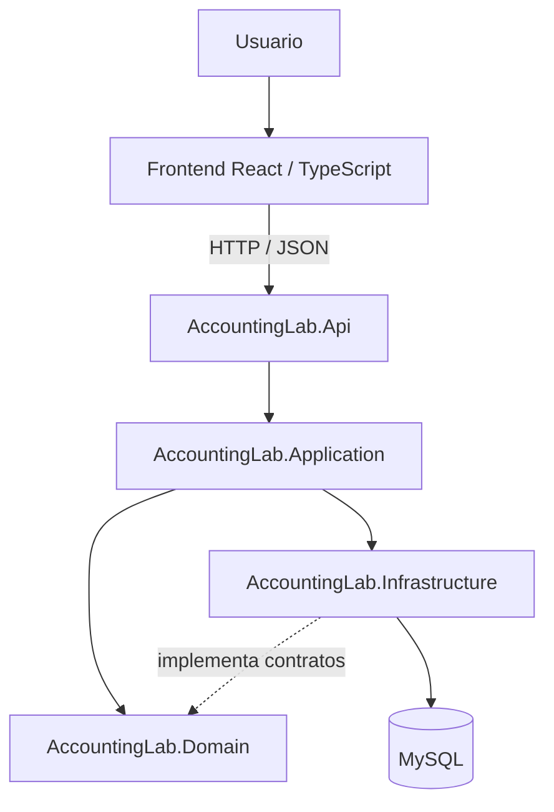


### 4.2 Responsabilidades por capa

| Capa | Responsabilidad | Regla de diseño |
|---|---|---|
| Domain | Entidades, objetos de valor, reglas de negocio, contratos e invariantes contables. | No depende de infraestructura, API, base de datos ni frontend. |
| Application | Casos de uso, coordinación de procesos, validación de solicitudes y orquestación. | Depende de abstracciones; no contiene detalles de persistencia. |
| Infrastructure | EF Core, MySQL, repositorios concretos, adaptadores técnicos e integraciones. | Implementa contratos definidos hacia el interior. |
| API | Controladores/endpoints HTTP, autenticación, transporte, serialización y respuestas. | No concentra reglas contables ni decisiones internas de patrones. |
| Frontend | Interfaz React/TypeScript, navegación, formularios y consumo HTTP. | No accede directamente a clases internas ni a la base de datos. |


### 4.3 Tecnologías identificadas

| Tecnología | Uso en AccountingLab |
|---|---|
| .NET 8 / C# | Backend, dominio, casos de uso y API. |
| ASP.NET Core | Servicios REST, autenticación y middleware. |
| Entity Framework Core 8.0.32 | Mapeo objeto-relacional y migraciones. |
| Pomelo.EntityFrameworkCore.MySql 8.0.3 | Proveedor EF Core para MySQL. |
| MySQL / MariaDB (según entorno) | Persistencia relacional. El README del proyecto fija MySQL 8.4 para Docker; el equipo local reportó MySQL Server 8.0.46 y conserva MariaDB 10.4.32 en XAMPP. |
| React 19.1.1 / TypeScript 5.8.3 | Frontend web independiente. |
| Vite 7.3.7 / Tailwind 4.1.18 / React Router 7.18.4 | Herramientas y presentación del frontend según README. |
| Swagger / OpenAPI | Exploración y documentación de contratos HTTP. |
| Docker Compose v2 | Ejecución coordinada de servicios y base de datos. |


### 4.4 Puertos documentados en el proyecto

| Componente | Puerto local documentado en README | Observación |
|---|---|---|
| Frontend web | 5173 | Servicio web local. |
| API | 5208 | Swagger en /swagger; health endpoints /health/live y /health/ready. |
| MySQL de demostración Docker | 3308 | Base por defecto accountinglab. |
| MySQL desechable de pruebas Docker | 3309 | Base separada para pruebas de integración. |
| MariaDB de XAMPP detectado en equipo | 3306 | MariaDB 10.4.32; proceso C:\xampp\mysql\bin\mysqld.exe, PID 22012. Se verificó conexión TCP y Workbench devolvió esta versión. |
| MySQL Server 8.0.46 local | 3307 verificado | Instalación, configuración y prueba de comunicación confirmadas por el estudiante en noviembre de 2026: versión 8.0.46 en el puerto 3307. No se debe confundir con MySQL 8.4 de Docker ni con MariaDB de XAMPP. |

> **Importante sobre puertos**  El README describe puertos Docker 3308 (demo) y 3309 (tests). La configuración manual de MySQL 8.4 en el equipo se planteó en 3307 para coexistir con XAMPP en 3306. Son escenarios distintos: debe elegirse la cadena de conexión que corresponda al entorno realmente iniciado.


## 5. REGLAS CONTABLES, TÉCNICAS Y DE SEGURIDAD


### 5.1 Precisión monetaria

- Los importes monetarios se representan en C# mediante decimal, no float ni double.
- En MySQL se utilizan columnas DECIMAL con precisión y escala adecuadas al contrato.
- El transporte JSON de importes se realiza mediante cadenas decimales para evitar pérdidas de precisión.
- Se conserva una precisión máxima de cuatro decimales en los escenarios definidos.


### 5.2 Integridad contable

- En cada asiento, la suma de débitos debe ser igual a la suma de créditos.
- Una operación financiera no debe confirmarse parcialmente.
- Los identificadores de operación deben proteger contra duplicados cuando el contrato lo exige.
- Los hechos contables contabilizados deben conservar su historia; las correcciones deben realizarse mediante mecanismos trazables autorizados.
- Las validaciones de negocio deben ejecutarse antes de confirmar la operación y dentro de la frontera transaccional adecuada.


### 5.3 Seguridad y aislamiento

El README documenta autenticación mediante token Bearer y selección de empresa activa por el encabezado X-Company-Id. Los usuarios solo deben acceder a empresas de las que tienen membresía. Se describen roles Administrador, Contador y Consulta con permisos diferenciados. La autorización debe comprobarse en servidor para cada operación, no solamente ocultando botones en el frontend.


### 5.4 Salud y disponibilidad

El proyecto documenta /health/live para comprobar que el proceso está vivo y /health/ready para comprobar disponibilidad de base de datos y esquema. La API depende de que las migraciones y los datos iniciales se ejecuten correctamente. Se debe evitar tener dos procesos responsables de migrar simultáneamente la misma base.


## 6. FUNDAMENTOS DE PATRONES Y PRINCIPIOS SOLID


### 6.1 Familias

| Familia | Cantidad | Intención | Patrones |
|---|---|---|---|
| Creacionales | 5 | Encapsular y controlar la creación de objetos. | Factory Method, Abstract Factory, Builder, Prototype, Singleton. |
| Estructurales | 7 | Organizar relaciones, adaptar interfaces y controlar acceso. | Adapter, Bridge, Composite, Decorator, Facade, Flyweight, Proxy. |
| Comportamiento | 10 | Distribuir responsabilidades y coordinar algoritmos y eventos. | Chain of Responsibility, Command, Iterator, Mediator, Memento, Observer, State, Strategy, Template Method, Visitor. |


### 6.2 Principios SOLID

| Principio | Aplicación en AccountingLab |
|---|---|
| SRP — Responsabilidad única | Separar creación, validación, coordinación, persistencia, transporte y autorización. |
| OCP — Abierto/cerrado | Permitir añadir tipos de comprobante, estrategias, formatos o validadores mediante abstracciones. |
| LSP — Sustitución de Liskov | Las implementaciones concretas respetan contratos, invariantes y expectativas de sus abstracciones. |
| ISP — Segregación de interfaces | Definir contratos enfocados para fábricas, proveedores, visitantes y servicios. |
| DIP — Inversión de dependencias | Los casos de uso dependen de contratos internos; Infrastructure implementa esos contratos. |

Los patrones no garantizan automáticamente SOLID. La aplicación correcta depende de que las interfaces sean coherentes, los contratos se respeten y las dependencias no inviertan la dirección de la arquitectura.


## 7. CATÁLOGO Y MATRIZ DE LOS 22 PATRONES

| ID | Patrón | Familia | Problema que aborda |
|---|---|---|---|
| DP-01 | Factory Method | Creacional | Comprobantes contables de ingreso, egreso, ajuste y traslado |
| DP-02 | Abstract Factory | Creacional | Familias compatibles de servicios contables por perfil y régimen ficticio |
| DP-03 | Builder | Creacional | Construcción progresiva de informes financieros |
| DP-04 | Prototype | Creacional | Duplicación independiente de plantillas contables |
| DP-05 | Singleton | Creacional | Registro de configuración inmutable compartido |
| DP-06 | Adapter | Estructural | Importación de movimientos desde dos proveedores bancarios ficticios |
| DP-07 | Bridge | Estructural | Separación de tipos de reportes y mecanismos de representación |
| DP-08 | Composite | Estructural | Jerarquía de cuentas individuales y grupos |
| DP-09 | Decorator | Estructural | Exportación de documentos con metadatos, auditoría o características opcionales |
| DP-10 | Facade | Estructural | Coordinación del cierre contable |
| DP-11 | Flyweight | Estructural | Compartición de metadatos inmutables de clasificación de movimientos |
| DP-12 | Proxy | Estructural | Acceso autorizado a informes confidenciales |
| DP-13 | Chain of Responsibility | Comportamiento | Aprobación configurable de solicitudes de pago |
| DP-14 | Command | Comportamiento | Ejecución trazable de cobros, pagos y reversiones |
| DP-15 | Iterator | Comportamiento | Recorrido de registros contables sin exponer la colección |
| DP-16 | Mediator | Comportamiento | Coordinación de componentes que procesan una factura |
| DP-17 | Memento | Comportamiento | Versionado y restauración de presupuestos en borrador |
| DP-18 | Observer | Comportamiento | Notificación de eventos financieros |
| DP-19 | State | Comportamiento | Transiciones válidas de facturas |
| DP-20 | Strategy | Comportamiento | Reglas tributarias ficticias configurables |
| DP-21 | Template Method | Comportamiento | Proceso general de conciliación bancaria |
| DP-22 | Visitor | Comportamiento | Análisis de documentos contables heterogéneos |

La matriz resume el propósito de cada desafío. La documentación detallada de los capítulos siguientes desarrolla el problema, intención, participantes, flujo, UML conceptual, arquitectura, validación, ventajas y limitaciones.


## 8. DESARROLLO DE LOS PATRONES CREACIONALES


### 8.1. DP-01 — FACTORY METHOD

| Atributo | Descripción |
|---|---|
| Patrón | Factory Method |
| Categoría | Creacional |
| Escenario contable | Comprobantes contables de ingreso, egreso, ajuste y traslado |
| Ubicación arquitectónica | Domain para contratos y reglas de comprobante; Application para seleccionar y coordinar el caso de uso. La ubicación exacta de cada fábrica debe cotejarse con el repositorio. |


#### DP-01.1 Problema y contexto

La creación de cada comprobante puede tener reglas y datos particulares. Si los consumidores instancian directamente las clases concretas, quedan acoplados a los tipos disponibles.


#### DP-01.2 Justificación e intención

Centralizar la decisión de construcción detrás de un contrato común, de modo que el consumidor solicite un comprobante sin conocer la clase concreta.


#### DP-01.3 Participantes y responsabilidades

Creador/contrato de fábrica; creadores concretos por tipo; producto abstracto o contrato común de comprobante; comprobantes concretos; consumidor.


#### DP-01.4 Flujo de ejecución

- El consumidor solicita el tipo de comprobante
- el creador correspondiente construye el objeto
- el resultado se entrega por el contrato común y luego se valida dentro del caso de uso


#### DP-01.5 UML conceptual de clases

El siguiente esquema representa roles y relaciones del patrón. Los nombres genéricos deben sustituirse por los nombres exactos de las clases e interfaces que existan en la versión final del repositorio.

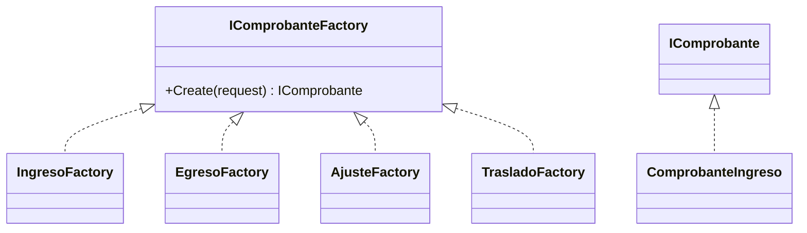


#### DP-01.6 Relación con SOLID y Clean Architecture

SRP separa construcción de uso; OCP facilita nuevos comprobantes; LSP exige contratos uniformes; DIP evita depender de clases concretas.


#### DP-01.7 Pruebas y criterios de aceptación

- Los siguientes escenarios constituyen criterios de validación que deben vincularse con el nombre real de cada prueba automatizada y con su resultado TRX o salida de consola.
- Tipo de comprobante soportado produce el subtipo esperado.
- Campos monetarios y referencias se conservan.
- Tipo desconocido se rechaza de forma controlada.
- Validaciones del comprobante se ejecutan antes de registrar el asiento.


#### DP-01.8 Ventajas

- Centraliza creación
- reduce acoplamiento
- facilita incorporar nuevos comprobantes


#### DP-01.9 Costos y limitaciones

- La fábrica debe conocer sus tipos
- no sustituye validaciones contables ni persistencia


#### DP-01.10 Conclusión técnica

Factory Method separa la construcción de la utilización del comprobante y permite que la aplicación trabaje con una abstracción común.


### 8.2. DP-02 — ABSTRACT FACTORY

| Atributo | Descripción |
|---|---|
| Patrón | Abstract Factory |
| Categoría | Creacional |
| Escenario contable | Familias compatibles de servicios contables por perfil y régimen ficticio |
| Ubicación arquitectónica | Dominio. En la documentación previa se identificó AccountingLab.Domain.Challenges.DP02AbstractFactory. |


#### DP-02.1 Problema y contexto

Crear por separado cálculo, validación e informe puede combinar componentes de perfiles o regímenes distintos.


#### DP-02.2 Justificación e intención

Construir familias de productos relacionados que comparten una configuración y clave de compatibilidad.


#### DP-02.3 Participantes y responsabilidades

AccountingProfileRequest; AccountingFamilyMember; AccountingServiceFamily; IAccountingServiceFactory; AccountingProfileChallenge. Contratos de creación: CreateCalculation, CreateValidation y CreateReport.


#### DP-02.4 Flujo de ejecución

- Se recibe perfil y régimen
- se selecciona la fábrica
- se crean los servicios de cálculo, validación e informe
- se comprueba compatibilidad
- se devuelve la familia


#### DP-02.5 UML conceptual de clases

El siguiente esquema representa roles y relaciones del patrón. Los nombres genéricos deben sustituirse por los nombres exactos de las clases e interfaces que existan en la versión final del repositorio.

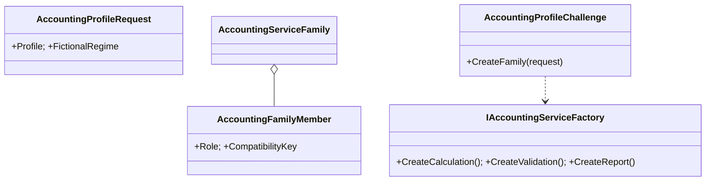


#### DP-02.6 Relación con SOLID y Clean Architecture

SRP asigna una responsabilidad por producto/fábrica; OCP incorpora familias; LSP mantiene compatibilidad; DIP hace que el consumidor dependa de la fábrica abstracta.


#### DP-02.7 Pruebas y criterios de aceptación

- Los siguientes escenarios constituyen criterios de validación que deben vincularse con el nombre real de cada prueba automatizada y con su resultado TRX o salida de consola.
- Crear familia según perfil y régimen.
- Conservar régimen ficticio solicitado.
- Generar integrantes esperados.
- Mantener una misma clave de compatibilidad.
- Rechazar perfiles o regímenes inválidos.


#### DP-02.8 Ventajas

- Evita mezclar familias
- encapsula construcción
- permite nuevas configuraciones


#### DP-02.9 Costos y limitaciones

- Añadir un nuevo producto de familia puede ampliar el contrato
- la compatibilidad debe validarse explícitamente


#### DP-02.10 Conclusión técnica

Abstract Factory permite agrupar servicios contables que deben compartir configuración sin exponer clases concretas al consumidor.


### 8.3. DP-03 — BUILDER

| Atributo | Descripción |
|---|---|
| Patrón | Builder |
| Categoría | Creacional |
| Escenario contable | Construcción progresiva de informes financieros |
| Ubicación arquitectónica | Application para coordinar el proceso de construcción; Domain para representar el resultado y sus invariantes. |


#### DP-03.1 Problema y contexto

Un informe puede requerir secciones, filtros, anexos y parámetros opcionales. Un constructor con muchos parámetros o múltiples sobrecargas se vuelve difícil de mantener.


#### DP-03.2 Justificación e intención

Construir un objeto complejo paso a paso, validando los componentes obligatorios antes de entregar el resultado.


#### DP-03.3 Participantes y responsabilidades

Director o caso de uso; interfaz/contrato de builder; builder concreto; producto InformeFinanciero con secciones, filtros y anexos.


#### DP-03.4 Flujo de ejecución

- El caso de uso inicia el builder
- agrega secciones y filtros
- configura anexos
- ejecuta Build
- el builder valida requisitos y entrega el informe completo


#### DP-03.5 UML conceptual de clases

El siguiente esquema representa roles y relaciones del patrón. Los nombres genéricos deben sustituirse por los nombres exactos de las clases e interfaces que existan en la versión final del repositorio.

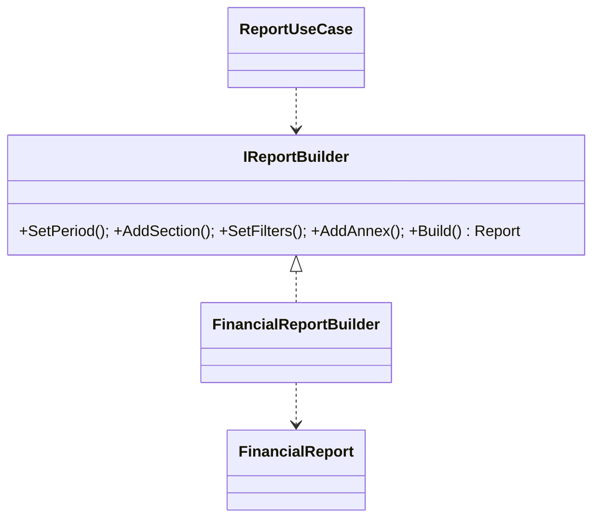


#### DP-03.6 Relación con SOLID y Clean Architecture

SRP separa dirección, construcción y producto; OCP permite variantes de informe; ISP define pasos necesarios; DIP usa el contrato del builder.


#### DP-03.7 Pruebas y criterios de aceptación

- Los siguientes escenarios constituyen criterios de validación que deben vincularse con el nombre real de cada prueba automatizada y con su resultado TRX o salida de consola.
- Rechazar informe sin periodo o sección obligatoria.
- Conservar filtros y anexos configurados.
- Permitir combinaciones válidas de secciones.
- Evitar exponer un objeto parcialmente construido.


#### DP-03.8 Ventajas

- Controla la construcción
- mejora legibilidad
- permite distintas representaciones del informe


#### DP-03.9 Costos y limitaciones

- Puede crear más clases
- el director/builder puede volverse complejo si hay demasiadas variantes


#### DP-03.10 Conclusión técnica

Builder es útil cuando la construcción tiene pasos y reglas, no simplemente cuando un objeto posee varios campos.


### 8.4. DP-04 — PROTOTYPE

| Atributo | Descripción |
|---|---|
| Patrón | Prototype |
| Categoría | Creacional |
| Escenario contable | Duplicación independiente de plantillas contables |
| Ubicación arquitectónica | Domain para reglas de clonación e invariantes de plantilla; Application para coordinar creación y almacenamiento. |


#### DP-04.1 Problema y contexto

Crear una plantilla similar a otra manualmente puede repetir configuración y producir errores. Una copia superficial puede compartir colecciones mutables con el original.


#### DP-04.2 Justificación e intención

Clonar un prototipo conservando los datos requeridos y asegurando independencia de los elementos mutables.


#### DP-04.3 Participantes y responsabilidades

Contrato de clonación; plantilla contable prototipo; implementación de clonación profunda; consumidor o servicio de plantillas.


#### DP-04.4 Flujo de ejecución

- Se selecciona una plantilla
- se solicita clonación
- se copian valores y colecciones
- se asigna nueva identidad cuando corresponda
- se modifica la copia sin afectar el original


#### DP-04.5 UML conceptual de clases

El siguiente esquema representa roles y relaciones del patrón. Los nombres genéricos deben sustituirse por los nombres exactos de las clases e interfaces que existan en la versión final del repositorio.

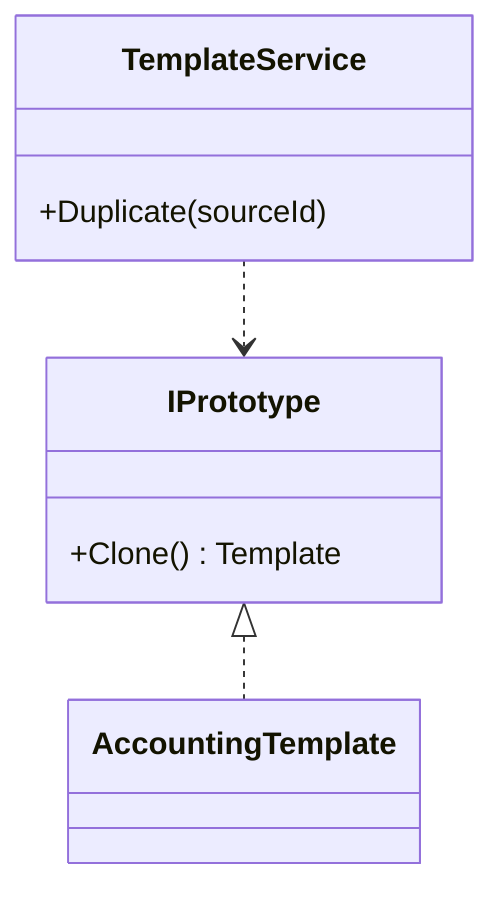


#### DP-04.6 Relación con SOLID y Clean Architecture

SRP concentra clonación; LSP mantiene tipo esperado; OCP permite nuevos prototipos; DIP evita que el consumidor conozca clases concretas.


#### DP-04.7 Pruebas y criterios de aceptación

- Los siguientes escenarios constituyen criterios de validación que deben vincularse con el nombre real de cada prueba automatizada y con su resultado TRX o salida de consola.
- La copia conserva datos esperados.
- La copia recibe identidad independiente cuando el modelo lo requiere.
- Cambiar colecciones de la copia no altera el original.
- La copia respeta restricciones del dominio.


#### DP-04.8 Ventajas

- Acelera creación de variantes
- reduce repetición de configuración


#### DP-04.9 Costos y limitaciones

- La clonación profunda puede ser costosa
- deben definirse claramente referencias compartidas e identidad


#### DP-04.10 Conclusión técnica

Prototype es apropiado cuando crear una instancia desde otra configuración existente es más seguro que reconstruirla campo por campo.


### 8.5. DP-05 — SINGLETON

| Atributo | Descripción |
|---|---|
| Patrón | Singleton |
| Categoría | Creacional |
| Escenario contable | Registro de configuración inmutable compartido |
| Ubicación arquitectónica | Domain si representa configuración inmutable propia del ejercicio; configuración de infraestructura debe mantenerse fuera del dominio. Confirmar alcance de instancia en código. |


#### DP-05.1 Problema y contexto

Distintos consumidores pueden requerir una misma configuración y no deben mantener copias divergentes dentro del alcance definido.


#### DP-05.2 Justificación e intención

Proporcionar un punto de acceso controlado a una única instancia, con estado inmutable y ciclo de vida explícito.


#### DP-05.3 Participantes y responsabilidades

Registro/configuración; mecanismo de acceso único; consumidor. En las conversaciones se identificó GlobalRegistryChallenge como clase del desafío.


#### DP-05.4 Flujo de ejecución

- El consumidor adquiere el registro
- las adquisiciones dentro del alcance esperado comparten identidad
- la configuración no se modifica durante el uso


#### DP-05.5 UML conceptual de clases

El siguiente esquema representa roles y relaciones del patrón. Los nombres genéricos deben sustituirse por los nombres exactos de las clases e interfaces que existan en la versión final del repositorio.

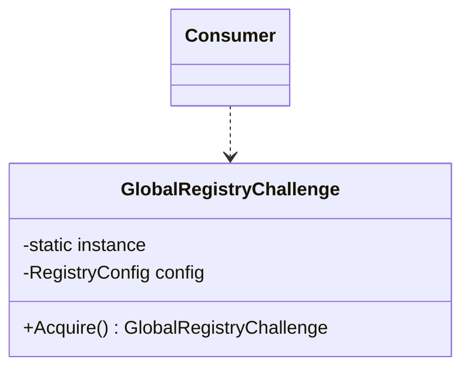


#### DP-05.6 Relación con SOLID y Clean Architecture

SRP delimita el registro; DIP permite consumir una abstracción; la unicidad no debe introducir dependencias globales innecesarias.


#### DP-05.7 Pruebas y criterios de aceptación

- Los siguientes escenarios constituyen criterios de validación que deben vincularse con el nombre real de cada prueba automatizada y con su resultado TRX o salida de consola.
- Adquisiciones repetidas comparten identidad dentro del proceso definido.
- La configuración permanece inmutable.
- No se crea estado global mutable innecesario.
- Pruebas no dependen del orden o contaminación entre procesos.


#### DP-05.8 Ventajas

- Evita duplicidad de registro
- acceso sencillo a configuración compartida


#### DP-05.9 Costos y limitaciones

- Introduce estado global y dificulta pruebas si se usa indiscriminadamente
- la unicidad debe definirse por proceso, contenedor o aplicación


#### DP-05.10 Conclusión técnica

Singleton se justifica únicamente cuando la unicidad forma parte del requisito; no debe usarse como sustituto de inyección de dependencias.


## 9. DESARROLLO DE LOS PATRONES ESTRUCTURALES


### 9.1. DP-06 — ADAPTER

| Atributo | Descripción |
|---|---|
| Patrón | Adapter |
| Categoría | Estructural |
| Escenario contable | Importación de movimientos desde dos proveedores bancarios ficticios |
| Ubicación arquitectónica | Infrastructure para adaptadores concretos de proveedores; contrato interno en Application/Domain según el diseño. Se confirmó en el trabajo que Adapter está en Infrastructure. |


#### DP-06.1 Problema y contexto

Los proveedores exponen estructuras incompatibles, nombres de campos o formatos distintos, mientras el proceso contable necesita un contrato uniforme.


#### DP-06.2 Justificación e intención

Convertir las interfaces de los proveedores al contrato que consume la aplicación sin cambiar el proveedor ni contaminar el dominio.


#### DP-06.3 Participantes y responsabilidades

Contrato común de importación; adaptador por proveedor; modelo normalizado de movimiento; proveedor externo ficticio.


#### DP-06.4 Flujo de ejecución

- El caso de uso recibe una solicitud
- el adaptador consulta o interpreta el formato del proveedor
- transforma fecha, referencia, importe y descripción
- devuelve movimientos normalizados


#### DP-06.5 UML conceptual de clases

El siguiente esquema representa roles y relaciones del patrón. Los nombres genéricos deben sustituirse por los nombres exactos de las clases e interfaces que existan en la versión final del repositorio.

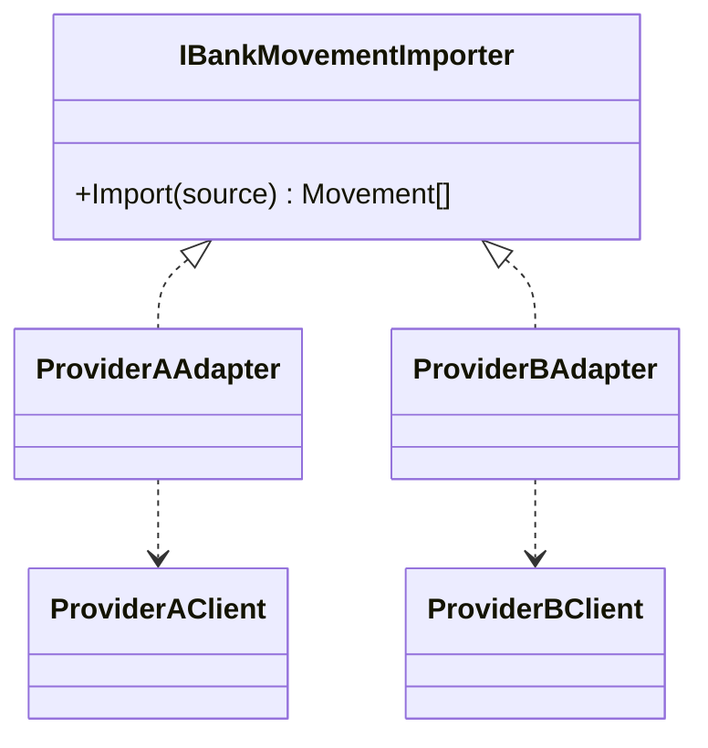


#### DP-06.6 Relación con SOLID y Clean Architecture

DIP permite que Application dependa del contrato normalizado; SRP concentra traducción en cada adaptador; OCP permite nuevos proveedores.


#### DP-06.7 Pruebas y criterios de aceptación

- Los siguientes escenarios constituyen criterios de validación que deben vincularse con el nombre real de cada prueba automatizada y con su resultado TRX o salida de consola.
- Ambos formatos se convierten al mismo contrato.
- Importes y signos se conservan.
- Fechas y referencias se normalizan correctamente.
- Formato inválido produce error controlado.
- No se depende de servicios bancarios reales.


#### DP-06.8 Ventajas

- Aísla formatos externos
- facilita añadir proveedores
- protege al dominio de contratos ajenos


#### DP-06.9 Costos y limitaciones

- Cada proveedor necesita mantenimiento
- una normalización deficiente puede perder información


#### DP-06.10 Conclusión técnica

Adapter desacopla el modelo contable interno de formatos externos y concentra la traducción en Infrastructure.


### 9.2. DP-07 — BRIDGE

| Atributo | Descripción |
|---|---|
| Patrón | Bridge |
| Categoría | Estructural |
| Escenario contable | Separación de tipos de reportes y mecanismos de representación |
| Ubicación arquitectónica | Domain/Application para definir contenido y caso de uso; Infrastructure o adaptadores de presentación para mecanismos concretos de exportación. |


#### DP-07.1 Problema y contexto

Si cada tipo de reporte se combina con cada formato mediante subclases, el número de clases crece combinatoriamente.


#### DP-07.2 Justificación e intención

Separar la abstracción del reporte de su implementación de salida para que ambas dimensiones evolucionen de forma independiente.


#### DP-07.3 Participantes y responsabilidades

Abstracción Report; implementor IReportRenderer; reportes concretos; renderizadores concretos para formatos como tabla, documento o salida estructurada según contratos reales.


#### DP-07.4 Flujo de ejecución

- El consumidor elige tipo de reporte y renderizador
- la abstracción delega la representación al implementor
- cada eje puede ampliarse sin multiplicar subclases


#### DP-07.5 UML conceptual de clases

El siguiente esquema representa roles y relaciones del patrón. Los nombres genéricos deben sustituirse por los nombres exactos de las clases e interfaces que existan en la versión final del repositorio.

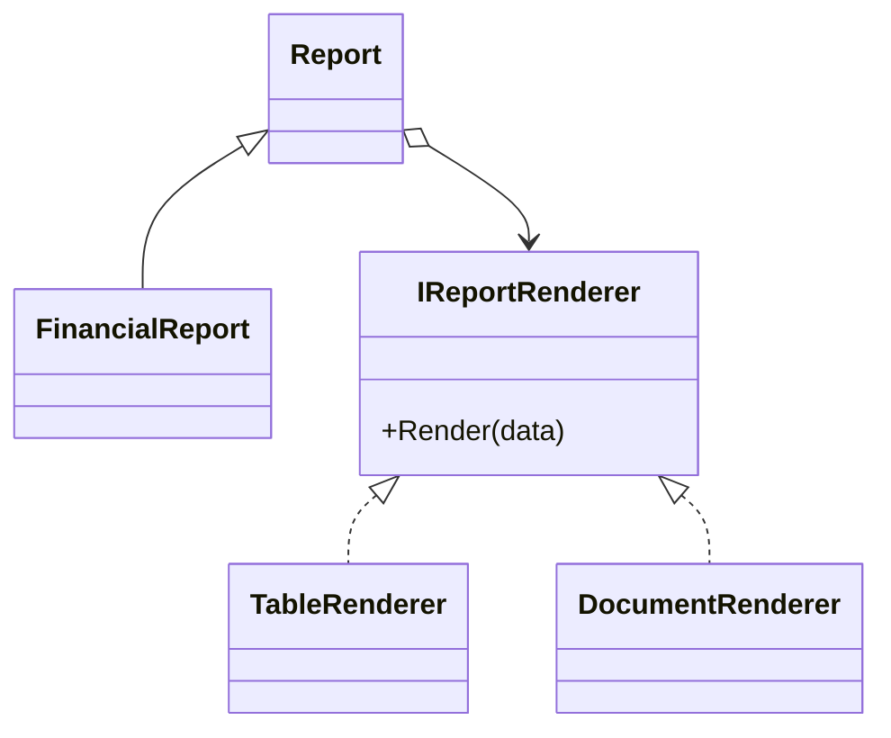


#### DP-07.6 Relación con SOLID y Clean Architecture

SRP separa contenido y representación; OCP permite nuevos tipos y formatos; DIP conecta abstracción con implementor.


#### DP-07.7 Pruebas y criterios de aceptación

- Los siguientes escenarios constituyen criterios de validación que deben vincularse con el nombre real de cada prueba automatizada y con su resultado TRX o salida de consola.
- Cada reporte funciona con más de un renderizador compatible.
- Añadir formato no exige duplicar todos los reportes.
- La salida respeta datos y orden definidos.
- Formato no soportado se rechaza.


#### DP-07.8 Ventajas

- Reduce explosión de subclases
- separa dos dimensiones de cambio


#### DP-07.9 Costos y limitaciones

Introduce dos jerarquías y requiere diseñar bien la abstracción y el implementor


#### DP-07.10 Conclusión técnica

Bridge es útil cuando reportes y formatos varían independientemente.


### 9.3. DP-08 — COMPOSITE

| Atributo | Descripción |
|---|---|
| Patrón | Composite |
| Categoría | Estructural |
| Escenario contable | Jerarquía de cuentas individuales y grupos |
| Ubicación arquitectónica | Domain para jerarquía e invariantes de cuentas; Application para consultas y agregaciones. |


#### DP-08.1 Problema y contexto

Un plan de cuentas puede contener cuentas hoja y grupos con subcuentas. El consumidor no debería necesitar lógica distinta para cada nivel.


#### DP-08.2 Justificación e intención

Representar objetos individuales y composiciones jerárquicas mediante un contrato común.


#### DP-08.3 Participantes y responsabilidades

Componente Cuenta; hoja CuentaIndividual; compuesto GrupoCuentas; colección de hijos; operación de consulta o agregación.


#### DP-08.4 Flujo de ejecución

- Se construye jerarquía
- el consumidor opera sobre el componente
- una cuenta hoja responde con su propio valor y un grupo delega o agrega sobre sus hijos


#### DP-08.5 UML conceptual de clases

El siguiente esquema representa roles y relaciones del patrón. Los nombres genéricos deben sustituirse por los nombres exactos de las clases e interfaces que existan en la versión final del repositorio.

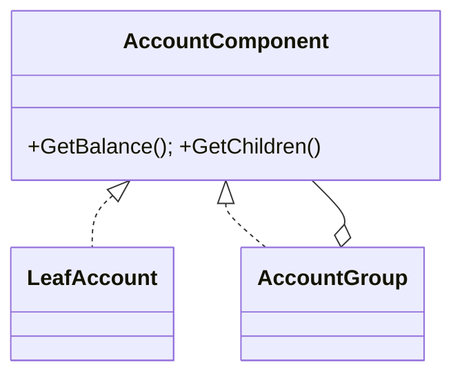


#### DP-08.6 Relación con SOLID y Clean Architecture

LSP exige que hoja y compuesto cumplan el contrato; OCP admite nuevos componentes; SRP mantiene la lógica de cada nodo.


#### DP-08.7 Pruebas y criterios de aceptación

- Los siguientes escenarios constituyen criterios de validación que deben vincularse con el nombre real de cada prueba automatizada y con su resultado TRX o salida de consola.
- Una cuenta individual no acepta hijos si el contrato lo prohíbe.
- Un grupo contiene hijos válidos.
- Los totales agregados corresponden a sus descendientes.
- Se evitan ciclos o referencias inválidas.


#### DP-08.8 Ventajas

- Uniforma tratamiento de hojas y grupos
- facilita consultas recursivas


#### DP-08.9 Costos y limitaciones

- Las restricciones de composición pueden ser complejas
- operaciones globales deben definirse para todos los componentes


#### DP-08.10 Conclusión técnica

Composite permite modelar el plan de cuentas como árbol y aplicar operaciones uniformes a distintos niveles.


### 9.4. DP-09 — DECORATOR

| Atributo | Descripción |
|---|---|
| Patrón | Decorator |
| Categoría | Estructural |
| Escenario contable | Exportación de documentos con metadatos, auditoría o características opcionales |
| Ubicación arquitectónica | Application para componer el proceso; Infrastructure para implementaciones de formatos y persistencia de archivos, según diseño. |


#### DP-09.1 Problema y contexto

Crear una subclase por cada combinación de opciones de exportación produce muchas clases y acoplamiento.


#### DP-09.2 Justificación e intención

Agregar responsabilidades opcionales envolviendo un componente que conserva el mismo contrato.


#### DP-09.3 Participantes y responsabilidades

Contrato de exportación; componente concreto; decorador base; decoradores concretos de metadatos, auditoría u opciones definidas.


#### DP-09.4 Flujo de ejecución

- El consumidor crea el exportador base
- envuelve con uno o más decoradores
- cada decorador delega al anterior y agrega su comportamiento


#### DP-09.5 UML conceptual de clases

El siguiente esquema representa roles y relaciones del patrón. Los nombres genéricos deben sustituirse por los nombres exactos de las clases e interfaces que existan en la versión final del repositorio.

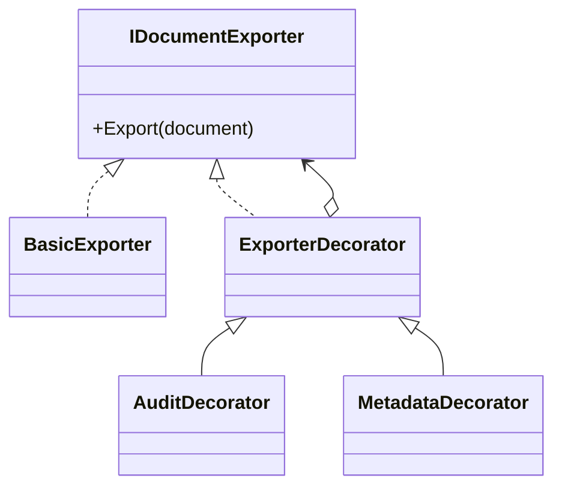


#### DP-09.6 Relación con SOLID y Clean Architecture

OCP permite agregar opciones por composición; SRP asigna una función a cada decorador; LSP conserva el contrato del exportador.


#### DP-09.7 Pruebas y criterios de aceptación

- Los siguientes escenarios constituyen criterios de validación que deben vincularse con el nombre real de cada prueba automatizada y con su resultado TRX o salida de consola.
- La salida base se conserva.
- Cada decorador agrega solo su responsabilidad.
- La combinación de decoradores produce resultado coherente.
- Errores de exportación no se ocultan.


#### DP-09.8 Ventajas

- Composición flexible
- evita herencia combinatoria
- respeta contrato común


#### DP-09.9 Costos y limitaciones

- El orden de decoradores puede afectar el resultado
- demasiadas capas dificultan depuración


#### DP-09.10 Conclusión técnica

Decorator permite incorporar opciones sin modificar el componente original ni crear una clase por combinación.


### 9.5. DP-10 — FACADE

| Atributo | Descripción |
|---|---|
| Patrón | Facade |
| Categoría | Estructural |
| Escenario contable | Coordinación del cierre contable |
| Ubicación arquitectónica | Application como caso de uso/fachada; Domain mantiene reglas; Infrastructure realiza persistencia/transacciones. |


#### DP-10.1 Problema y contexto

El cierre contable implica varias operaciones y validaciones. Exponer todos los componentes internos al controlador o al cliente aumenta acoplamiento y riesgo de omitir pasos.


#### DP-10.2 Justificación e intención

Proporcionar una interfaz de alto nivel que coordina el subsistema y ofrece una operación simple al consumidor.


#### DP-10.3 Participantes y responsabilidades

Facade de cierre; validadores; servicios de periodo, asientos y reportes; repositorios/transacciones; resultado de cierre.


#### DP-10.4 Flujo de ejecución

- El consumidor solicita cerrar periodo
- la fachada verifica estado y permisos
- coordina validaciones, conciliaciones y operaciones requeridas
- confirma transacción y devuelve resultado


#### DP-10.5 UML conceptual de clases

El siguiente esquema representa roles y relaciones del patrón. Los nombres genéricos deben sustituirse por los nombres exactos de las clases e interfaces que existan en la versión final del repositorio.

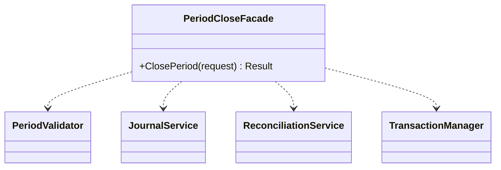


#### DP-10.6 Relación con SOLID y Clean Architecture

SRP exige que la fachada coordine y delegue; DIP usa contratos de subsistemas; no debe absorber reglas que pertenecen al dominio.


#### DP-10.7 Pruebas y criterios de aceptación

- Los siguientes escenarios constituyen criterios de validación que deben vincularse con el nombre real de cada prueba automatizada y con su resultado TRX o salida de consola.
- No cerrar si existen asientos desequilibrados o errores pendientes.
- No confirmar parcialmente.
- Periodo cerrado no se modifica sin flujo autorizado.
- La operación es trazable e idempotente según contrato.


#### DP-10.8 Ventajas

- Simplifica API de subsistema
- centraliza coordinación
- reduce conocimiento del consumidor


#### DP-10.9 Costos y limitaciones

Puede convertirse en clase demasiado grande si absorbe reglas que pertenecen a otros servicios


#### DP-10.10 Conclusión técnica

Facade ofrece un punto de entrada simple, pero debe delegar responsabilidades en componentes especializados.


### 9.6. DP-11 — FLYWEIGHT

| Atributo | Descripción |
|---|---|
| Patrón | Flyweight |
| Categoría | Estructural |
| Escenario contable | Compartición de metadatos inmutables de clasificación de movimientos |
| Ubicación arquitectónica | Domain. En el trabajo se identificaron los records MovementClassificationInput, ClassificationMetadata y ClassifiedMovement en DP11Flyweight. |


#### DP-11.1 Problema y contexto

Muchos movimientos pueden repetir metadatos como código, etiqueta y ámbito tributario. Duplicarlos aumenta memoria y riesgo de divergencia.


#### DP-11.2 Justificación e intención

Compartir estado intrínseco inmutable y mantener separado el estado extrínseco propio de cada movimiento.


#### DP-11.3 Participantes y responsabilidades

MovementClassificationInput; ClassificationMetadata; ClassifiedMovement; fábrica/almacén de metadatos compartidos; contrato de clasificación.


#### DP-11.4 Flujo de ejecución

- El proceso recibe movimientos
- obtiene metadatos compartidos por clave
- cada resultado conserva su Id e importe, pero referencia los metadatos inmutables


#### DP-11.5 UML conceptual de clases

El siguiente esquema representa roles y relaciones del patrón. Los nombres genéricos deben sustituirse por los nombres exactos de las clases e interfaces que existan en la versión final del repositorio.

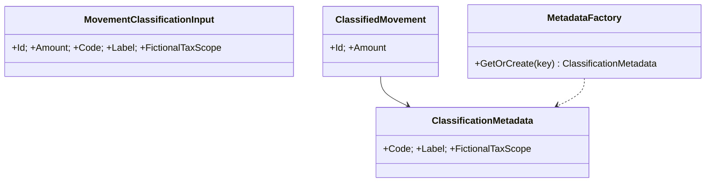


#### DP-11.6 Relación con SOLID y Clean Architecture

SRP separa metadatos intrínsecos del estado extrínseco; inmutabilidad favorece seguridad; DIP abstrae el acceso a metadatos compartidos.


#### DP-11.7 Pruebas y criterios de aceptación

- Los siguientes escenarios constituyen criterios de validación que deben vincularse con el nombre real de cada prueba automatizada y con su resultado TRX o salida de consola.
- Movimientos con misma clave comparten instancia/metadatos.
- Id e importe siguen siendo propios del movimiento.
- Metadatos son inmutables.
- Claves diferentes no se mezclan.


#### DP-11.8 Ventajas

- Reduce duplicación
- promueve metadatos consistentes
- puede ahorrar memoria


#### DP-11.9 Costos y limitaciones

- La caché/almacén debe tener ciclo de vida y concurrencia definidos
- no conviene compartir estado mutable


#### DP-11.10 Conclusión técnica

Flyweight distingue datos comunes reutilizables de datos particulares de cada movimiento.


### 9.7. DP-12 — PROXY

| Atributo | Descripción |
|---|---|
| Patrón | Proxy |
| Categoría | Estructural |
| Escenario contable | Acceso autorizado a informes confidenciales |
| Ubicación arquitectónica | Application para contrato y política/caso de uso; Infrastructure puede alojar acceso a datos; API autentica y transmite contexto. No confiar solo en UI. |


#### DP-12.1 Problema y contexto

Los informes sensibles requieren autorización y control de acceso sin que el consumidor tenga que implementar seguridad por su cuenta.


#### DP-12.2 Justificación e intención

Interponer un objeto que conserva el contrato del servicio real y controla el acceso antes de delegar.


#### DP-12.3 Participantes y responsabilidades

Contrato IConfidentialReportService; Proxy; servicio real; contexto de usuario/empresa; política de autorización.


#### DP-12.4 Flujo de ejecución

- El consumidor solicita informe
- el proxy verifica identidad, empresa y permisos
- si está autorizado delega al servicio real
- de lo contrario rechaza sin revelar datos


#### DP-12.5 UML conceptual de clases

El siguiente esquema representa roles y relaciones del patrón. Los nombres genéricos deben sustituirse por los nombres exactos de las clases e interfaces que existan en la versión final del repositorio.

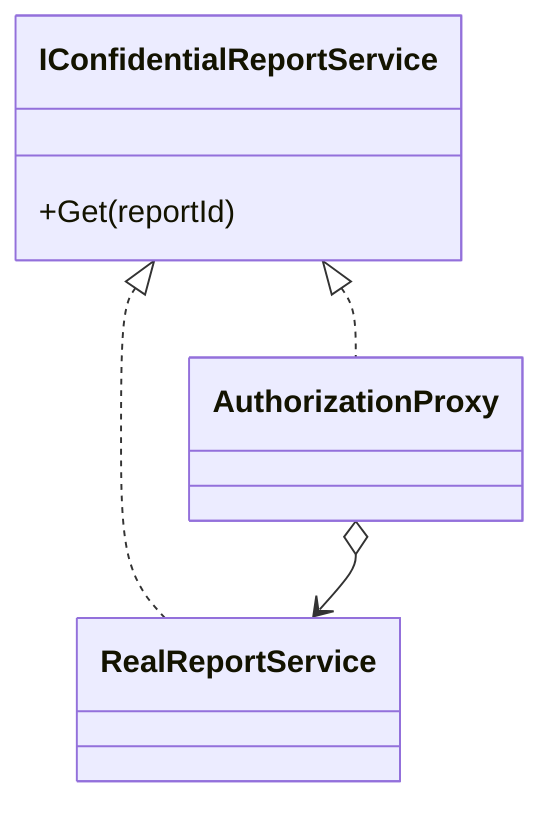


#### DP-12.6 Relación con SOLID y Clean Architecture

DIP mantiene contrato común entre proxy y servicio real; SRP concentra autorización; LSP exige respuestas compatibles.


#### DP-12.7 Pruebas y criterios de aceptación

- Los siguientes escenarios constituyen criterios de validación que deben vincularse con el nombre real de cada prueba automatizada y con su resultado TRX o salida de consola.
- Usuario autorizado obtiene informe esperado.
- Usuario sin permiso recibe rechazo controlado.
- Empresa A no accede al informe de empresa B.
- La respuesta no filtra datos antes de autorización.


#### DP-12.8 Ventajas

- Centraliza control de acceso
- conserva interfaz del servicio
- facilita auditoría


#### DP-12.9 Costos y limitaciones

- Puede añadir latencia
- riesgo de duplicar autorización si no se define una política única


#### DP-12.10 Conclusión técnica

Proxy aplica control previo al acceso sin alterar la interfaz del objeto real.


## 10. DESARROLLO DE LOS PATRONES DE COMPORTAMIENTO


### 10.1. DP-13 — CHAIN OF RESPONSIBILITY

| Atributo | Descripción |
|---|---|
| Patrón | Chain of Responsibility |
| Categoría | Comportamiento |
| Escenario contable | Aprobación configurable de solicitudes de pago |
| Ubicación arquitectónica | Application para coordinar cadena; Domain para reglas y criterios de aprobación. |


#### DP-13.1 Problema y contexto

Las solicitudes pueden requerir distintos niveles de revisión. Un único bloque condicional mezcla reglas y dificulta cambiar el orden de aprobación.


#### DP-13.2 Justificación e intención

Encadenar validadores o aprobadores; cada eslabón decide, rechaza o delega al siguiente.


#### DP-13.3 Participantes y responsabilidades

Contrato ApprovalHandler; handlers concretos por nivel/regla; solicitud de pago; resultado de aprobación; enlace al siguiente handler.


#### DP-13.4 Flujo de ejecución

- Se recibe solicitud
- cada handler valida su responsabilidad
- puede rechazar, aprobar o pasar al siguiente
- la cadena termina con decisión explícita


#### DP-13.5 UML conceptual de clases

El siguiente esquema representa roles y relaciones del patrón. Los nombres genéricos deben sustituirse por los nombres exactos de las clases e interfaces que existan en la versión final del repositorio.

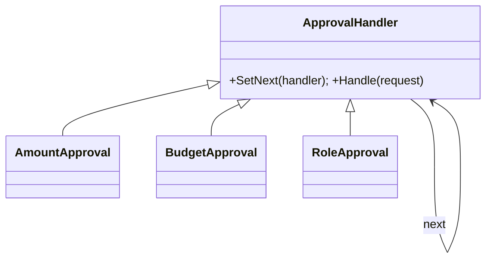


#### DP-13.6 Relación con SOLID y Clean Architecture

OCP permite nuevos handlers; SRP asigna una regla a cada eslabón; LSP exige contrato uniforme de manejo.


#### DP-13.7 Pruebas y criterios de aceptación

- Los siguientes escenarios constituyen criterios de validación que deben vincularse con el nombre real de cada prueba automatizada y con su resultado TRX o salida de consola.
- Cada nivel aplica su regla.
- Un rechazo detiene la cadena.
- La solicitud no aprobada no se ejecuta.
- La cadena sin handler finaliza con resultado explícito.


#### DP-13.8 Ventajas

- Permite reordenar o añadir niveles
- reduce condicionales centrales


#### DP-13.9 Costos y limitaciones

- El resultado puede ser difícil de rastrear si la cadena no registra decisiones
- un handler omitido puede dejar solicitudes sin decisión


#### DP-13.10 Conclusión técnica

Chain of Responsibility distribuye evaluación sin acoplar el emisor a un aprobador concreto.


### 10.2. DP-14 — COMMAND

| Atributo | Descripción |
|---|---|
| Patrón | Command |
| Categoría | Comportamiento |
| Escenario contable | Ejecución trazable de cobros, pagos y reversiones |
| Ubicación arquitectónica | Application para comandos/handlers; Domain para reglas; Infrastructure para persistencia y transacción. |


#### DP-14.1 Problema y contexto

Invocar operaciones financieras directamente dificulta registrar intención, identificar duplicados, auditar y controlar reintentos.


#### DP-14.2 Justificación e intención

Encapsular cada operación como objeto/comando con datos, identificador y ejecutor.


#### DP-14.3 Participantes y responsabilidades

ICommand; comandos concretos de cobro, pago y reversión; receptor/servicio de operaciones; invocador; OperationId y resultado.


#### DP-14.4 Flujo de ejecución

- El invocador recibe comando
- valida identificador
- el handler ejecuta en transacción
- registra resultado
- repetición con mismo identificador no debe duplicar el efecto


#### DP-14.5 UML conceptual de clases

El siguiente esquema representa roles y relaciones del patrón. Los nombres genéricos deben sustituirse por los nombres exactos de las clases e interfaces que existan en la versión final del repositorio.

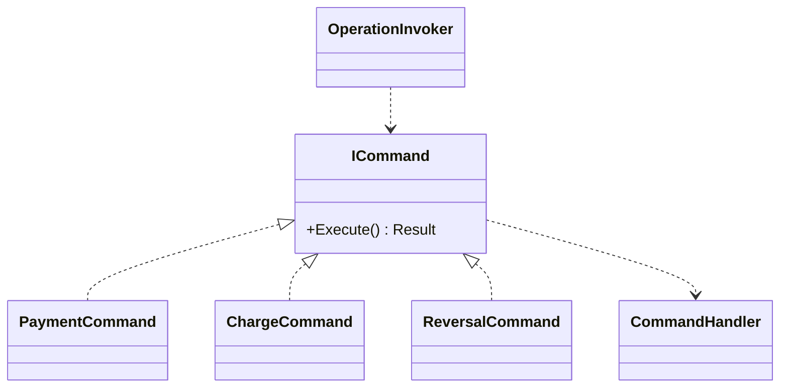


#### DP-14.6 Relación con SOLID y Clean Architecture

SRP separa comando, invocador y handler; OCP admite nuevos comandos; DIP usa contratos y abstrae el ejecutor.


#### DP-14.7 Pruebas y criterios de aceptación

- Los siguientes escenarios constituyen criterios de validación que deben vincularse con el nombre real de cada prueba automatizada y con su resultado TRX o salida de consola.
- Comando válido produce efecto esperado.
- Mismo OperationId no duplica operación.
- Reversión conserva trazabilidad y referencia al original.
- Fallo transaccional no deja estado parcial.


#### DP-14.8 Ventajas

- Auditoría
- reintentos controlados
- separación entre solicitud y ejecución


#### DP-14.9 Costos y limitaciones

- Requiere almacenamiento de idempotencia y gestión de errores
- no todos los comandos deben almacenarse indefinidamente


#### DP-14.10 Conclusión técnica

Command convierte una solicitud en objeto explícito que puede validarse, registrar y ejecutar de forma controlada.


### 10.3. DP-15 — ITERATOR

| Atributo | Descripción |
|---|---|
| Patrón | Iterator |
| Categoría | Comportamiento |
| Escenario contable | Recorrido de registros contables sin exponer la colección |
| Ubicación arquitectónica | Domain/Application según el contrato y el caso de uso; repositorio puede entregar una secuencia paginada. |


#### DP-15.1 Problema y contexto

Los consumidores necesitan recorrer asientos o movimientos, pero no deben depender de la estructura interna de almacenamiento.


#### DP-15.2 Justificación e intención

Ofrecer un mecanismo uniforme para recorrer elementos secuencialmente y controlar el estado del recorrido.


#### DP-15.3 Participantes y responsabilidades

Contrato Iterator; colección Aggregate; iterador concreto; elemento RegistroContable; consumidor.


#### DP-15.4 Flujo de ejecución

- El consumidor solicita iterador
- llama MoveNext/Current o equivalente
- el iterador mantiene posición y expone elementos sin revelar la colección


#### DP-15.5 UML conceptual de clases

El siguiente esquema representa roles y relaciones del patrón. Los nombres genéricos deben sustituirse por los nombres exactos de las clases e interfaces que existan en la versión final del repositorio.

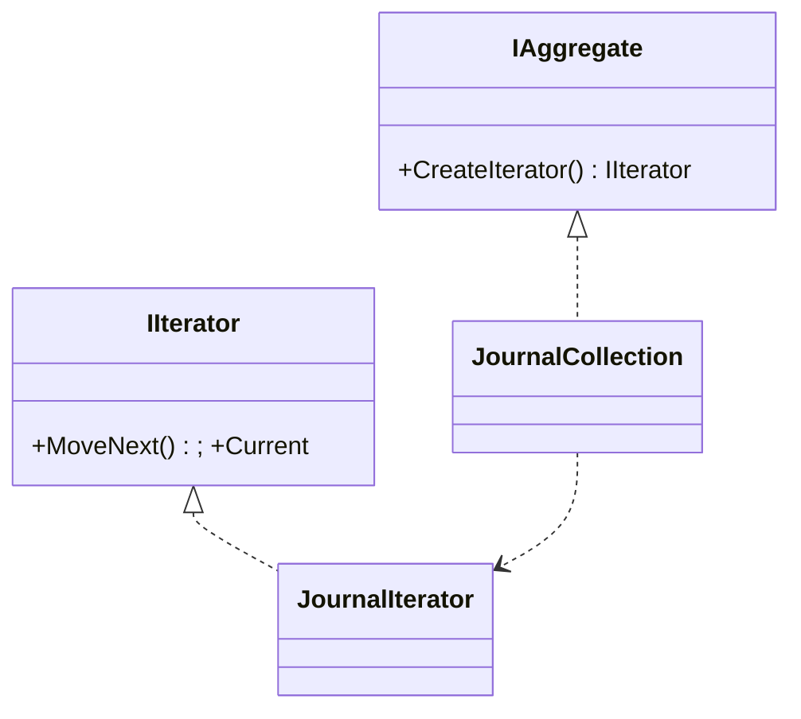


#### DP-15.6 Relación con SOLID y Clean Architecture

ISP define operaciones mínimas del iterador; SRP separa colección y recorrido; DIP evita depender de estructura concreta.


#### DP-15.7 Pruebas y criterios de aceptación

- Los siguientes escenarios constituyen criterios de validación que deben vincularse con el nombre real de cada prueba automatizada y con su resultado TRX o salida de consola.
- Recorre todos los elementos una sola vez en orden definido.
- Colección vacía termina correctamente.
- No permite alterar colección interna indebidamente.
- Paginación o concurrencia tiene semántica documentada.


#### DP-15.8 Ventajas

- Oculta estructura
- permite recorridos alternativos
- simplifica consumidores


#### DP-15.9 Costos y limitaciones

Iteradores sobre grandes volúmenes deben controlar memoria, consistencia y paginación


#### DP-15.10 Conclusión técnica

Iterator desacopla el algoritmo de recorrido de la representación de la colección.


### 10.4. DP-16 — MEDIATOR

| Atributo | Descripción |
|---|---|
| Patrón | Mediator |
| Categoría | Comportamiento |
| Escenario contable | Coordinación de componentes que procesan una factura |
| Ubicación arquitectónica | Application para orquestación; Domain para invariantes de factura y componentes de negocio. |


#### DP-16.1 Problema y contexto

Los componentes de una factura pueden necesitar comunicarse entre sí. Las referencias directas entre todos generan acoplamiento en forma de malla.


#### DP-16.2 Justificación e intención

Centralizar la coordinación en un mediador, evitando que cada componente conozca a los demás.


#### DP-16.3 Participantes y responsabilidades

Contrato Mediator; componentes de factura; mediador concreto; solicitud y resultado del procesamiento.


#### DP-16.4 Flujo de ejecución

- Un componente notifica al mediador
- este decide qué componente activar, valida el orden y coordina el flujo de factura


#### DP-16.5 UML conceptual de clases

El siguiente esquema representa roles y relaciones del patrón. Los nombres genéricos deben sustituirse por los nombres exactos de las clases e interfaces que existan en la versión final del repositorio.

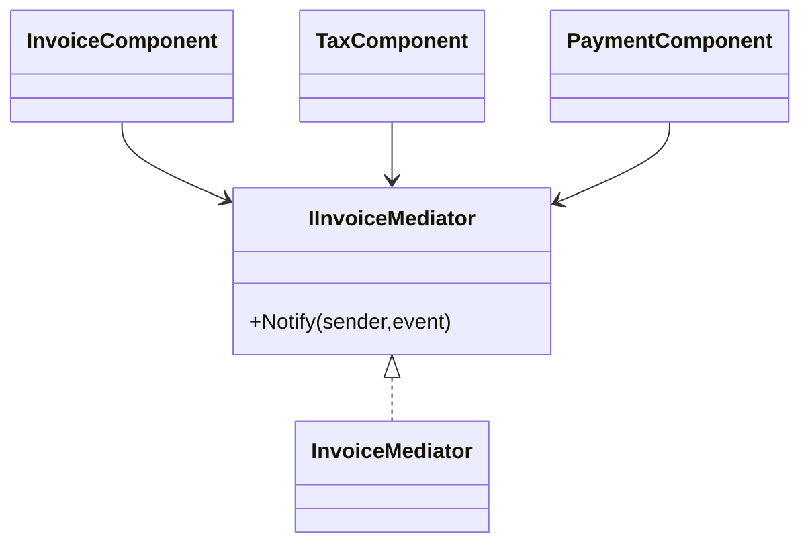


#### DP-16.6 Relación con SOLID y Clean Architecture

SRP separa componentes y coordinación; DIP hace que los componentes dependan del mediador; OCP facilita nuevos participantes.


#### DP-16.7 Pruebas y criterios de aceptación

- Los siguientes escenarios constituyen criterios de validación que deben vincularse con el nombre real de cada prueba automatizada y con su resultado TRX o salida de consola.
- Componentes no dependen directamente unos de otros.
- El mediador ejecuta pasos en orden válido.
- Error en etapa impide confirmar factura incompleta.
- Las notificaciones no provocan ciclos.


#### DP-16.8 Ventajas

- Reduce dependencias directas
- concentra coordinación del flujo


#### DP-16.9 Costos y limitaciones

- El mediador puede convertirse en objeto omnisciente
- debe delegar reglas específicas


#### DP-16.10 Conclusión técnica

Mediator organiza la colaboración, no debe absorber la lógica propia de cada componente.


### 10.5. DP-17 — MEMENTO

| Atributo | Descripción |
|---|---|
| Patrón | Memento |
| Categoría | Comportamiento |
| Escenario contable | Versionado y restauración de presupuestos en borrador |
| Ubicación arquitectónica | Domain para estado y reglas de restauración; Application para historial y autorización; Infrastructure para persistir versiones si corresponde. |


#### DP-17.1 Problema y contexto

El usuario necesita guardar una versión anterior de un presupuesto sin exponer internamente todos sus campos ni permitir restaurar estados que ya fueron formalizados.


#### DP-17.2 Justificación e intención

Capturar y restaurar el estado de un objeto mediante un memento opaco y controlado.


#### DP-17.3 Participantes y responsabilidades

Originator Presupuesto; Memento/versión; Caretaker o servicio de historial; identificador y estado del presupuesto.


#### DP-17.4 Flujo de ejecución

- El presupuesto en borrador crea snapshot
- el caretaker conserva versión
- ante solicitud autorizada se valida estado actual
- se restaura únicamente si sigue siendo borrador


#### DP-17.5 UML conceptual de clases

El siguiente esquema representa roles y relaciones del patrón. Los nombres genéricos deben sustituirse por los nombres exactos de las clases e interfaces que existan en la versión final del repositorio.

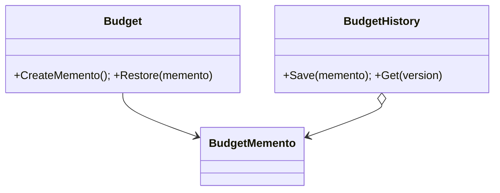


#### DP-17.6 Relación con SOLID y Clean Architecture

SRP separa originator, memento y caretaker; encapsulación protege el estado; reglas de dominio restringen restauración a borradores.


#### DP-17.7 Pruebas y criterios de aceptación

- Los siguientes escenarios constituyen criterios de validación que deben vincularse con el nombre real de cada prueba automatizada y con su resultado TRX o salida de consola.
- Permite capturar versiones de borrador.
- La restauración reproduce valores de la versión elegida.
- Presupuesto contabilizado/enviado no puede restaurarse por esta vía.
- Versiones no se alteran retroactivamente.


#### DP-17.8 Ventajas

- Historial controlado
- encapsula estado
- facilita recuperar borradores


#### DP-17.9 Costos y limitaciones

- Snapshots pueden consumir almacenamiento
- compatibilidad entre versiones requiere estrategia


#### DP-17.10 Conclusión técnica

Memento conserva estado sin romper encapsulación y respeta la restricción del docente: restaurar solo borradores.


### 10.6. DP-18 — OBSERVER

| Atributo | Descripción |
|---|---|
| Patrón | Observer |
| Categoría | Comportamiento |
| Escenario contable | Notificación de eventos financieros |
| Ubicación arquitectónica | Domain/Application para eventos y contratos; Infrastructure para transporte externo o persistencia de outbox si existe. |


#### DP-18.1 Problema y contexto

Varios interesados pueden necesitar reaccionar a un evento financiero. Si el emisor conoce a todos los consumidores, aumenta el acoplamiento.


#### DP-18.2 Justificación e intención

Publicar cambios a suscriptores registrados mediante un contrato de observación.


#### DP-18.3 Participantes y responsabilidades

Publisher/Subject; contrato Observer/Handler; evento financiero; suscriptores; dispatcher o notificador.


#### DP-18.4 Flujo de ejecución

- Se produce evento
- se publica
- los suscriptores registrados reciben el mensaje
- fallos de notificación se manejan sin invalidar indebidamente una transacción ya confirmada


#### DP-18.5 UML conceptual de clases

El siguiente esquema representa roles y relaciones del patrón. Los nombres genéricos deben sustituirse por los nombres exactos de las clases e interfaces que existan en la versión final del repositorio.

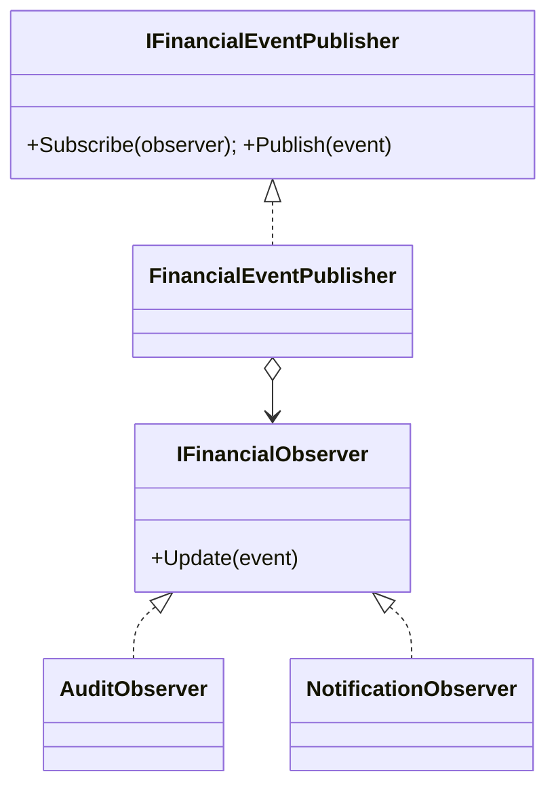


#### DP-18.6 Relación con SOLID y Clean Architecture

OCP permite suscriptores nuevos; DIP usa contratos de observación; SRP separa publicación, evento y reacción.


#### DP-18.7 Pruebas y criterios de aceptación

- Los siguientes escenarios constituyen criterios de validación que deben vincularse con el nombre real de cada prueba automatizada y con su resultado TRX o salida de consola.
- Suscriptores reciben evento correcto.
- Suscripción y cancelación funcionan.
- No se notifica operación que fue revertida.
- Eventos duplicados se manejan de forma idempotente cuando el transporte lo exige.


#### DP-18.8 Ventajas

- Desacopla emisor y consumidores
- permite incorporar nuevas reacciones


#### DP-18.9 Costos y limitaciones

- Orden, duplicados y fallos asíncronos requieren diseño
- publicar antes del commit puede generar eventos falsos


#### DP-18.10 Conclusión técnica

Observer comunica cambios sin acoplar el origen a todos los interesados; para consistencia transaccional considerar outbox.


### 10.7. DP-19 — STATE

| Atributo | Descripción |
|---|---|
| Patrón | State |
| Categoría | Comportamiento |
| Escenario contable | Transiciones válidas de facturas |
| Ubicación arquitectónica | Domain para estados y transiciones; Application para caso de uso y autorización; Infrastructure para persistencia. |


#### DP-19.1 Problema y contexto

Una factura tiene reglas diferentes según su estado. Condicionales repetidos por todo el sistema permiten transiciones inválidas.


#### DP-19.2 Justificación e intención

Delegar comportamiento y transiciones al objeto que representa el estado actual.


#### DP-19.3 Participantes y responsabilidades

Factura; contrato InvoiceState; estados concretos (borrador, emitida, pagada, anulada u otros definidos en el modelo); servicio de transición.


#### DP-19.4 Flujo de ejecución

- La factura recibe una acción
- el estado actual valida si la transición está permitida
- cambia estado o rechaza operación con motivo explícito


#### DP-19.5 UML conceptual de clases

El siguiente esquema representa roles y relaciones del patrón. Los nombres genéricos deben sustituirse por los nombres exactos de las clases e interfaces que existan en la versión final del repositorio.

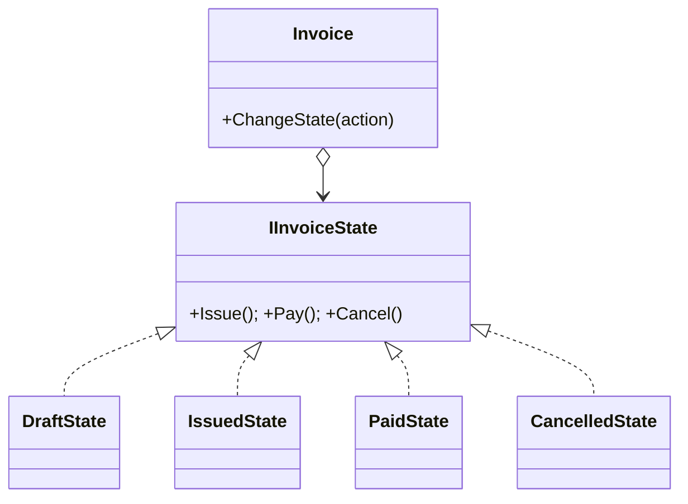


#### DP-19.6 Relación con SOLID y Clean Architecture

SRP asigna reglas a estados; OCP permite nuevos estados; LSP exige transiciones coherentes; el dominio protege invariantes.


#### DP-19.7 Pruebas y criterios de aceptación

- Los siguientes escenarios constituyen criterios de validación que deben vincularse con el nombre real de cada prueba automatizada y con su resultado TRX o salida de consola.
- Transición permitida cambia estado.
- Transición prohibida se rechaza.
- No se puede pagar factura anulada si la regla lo impide.
- El historial conserva transiciones relevantes.


#### DP-19.8 Ventajas

- Centraliza reglas de estado
- evita condicionales dispersos
- facilita agregar estados


#### DP-19.9 Costos y limitaciones

- Puede aumentar clases
- el modelo de transiciones debe evitar combinaciones inconsistentes


#### DP-19.10 Conclusión técnica

State modela reglas dependientes del estado y protege el ciclo de vida de la factura.


### 10.8. DP-20 — STRATEGY

| Atributo | Descripción |
|---|---|
| Patrón | Strategy |
| Categoría | Comportamiento |
| Escenario contable | Reglas tributarias ficticias configurables |
| Ubicación arquitectónica | Domain para reglas y cálculos; Application para seleccionar estrategia y coordinar; Infrastructure para cargar configuración persistida. |


#### DP-20.1 Problema y contexto

Las reglas de cálculo pueden variar por vigencia, tipo de operación y configuración del ejercicio. Condicionales rígidos dificultan cambiar o probar algoritmos.


#### DP-20.2 Justificación e intención

Definir una familia de algoritmos intercambiables y seleccionar la estrategia adecuada mediante criterios explícitos.


#### DP-20.3 Participantes y responsabilidades

Contrato ITaxStrategy; estrategias concretas; contexto de cálculo; selector/fábrica; configuración ficticia y periodo de vigencia.


#### DP-20.4 Flujo de ejecución

- Se recibe operación
- selector determina estrategia válida
- estrategia calcula impuesto
- resultado conserva desglose y precisión decimal


#### DP-20.5 UML conceptual de clases

El siguiente esquema representa roles y relaciones del patrón. Los nombres genéricos deben sustituirse por los nombres exactos de las clases e interfaces que existan en la versión final del repositorio.

```mermaid
classDiagram
  class ITaxStrategy { +CalculateTax(operation) TaxResult }
  class TaxStrategyA
  class TaxStrategyB
  class TaxContext
  class TaxStrategySelector
  ITaxStrategy <|.. TaxStrategyA
  ITaxStrategy <|.. TaxStrategyB
  TaxContext o--> ITaxStrategy
  TaxStrategySelector ..> ITaxStrategy
```


#### DP-20.6 Relación con SOLID y Clean Architecture

OCP permite nuevas reglas; LSP exige estrategias intercambiables; DIP hace que el contexto dependa de ITaxStrategy.


#### DP-20.7 Pruebas y criterios de aceptación

- Los siguientes escenarios constituyen criterios de validación que deben vincularse con el nombre real de cada prueba automatizada y con su resultado TRX o salida de consola.
- Selecciona estrategia por vigencia y tipo de operación.
- Datos ficticios son configurables.
- Cálculo usa decimal y precisión definida.
- Ausencia de estrategia válida se informa sin aplicar regla arbitraria.


#### DP-20.8 Ventajas

- Permite variar algoritmos
- facilita pruebas unitarias
- evita condicionales centralizados


#### DP-20.9 Costos y limitaciones

- Multiplica clases/estrategias
- selección y vigencia deben ser inequívocas
- no representa asesoría tributaria real


#### DP-20.10 Conclusión técnica

Strategy encapsula algoritmos tributarios ficticios y permite sustituirlos sin alterar el caso de uso.


### 10.9. DP-21 — TEMPLATE METHOD

| Atributo | Descripción |
|---|---|
| Patrón | Template Method |
| Categoría | Comportamiento |
| Escenario contable | Proceso general de conciliación bancaria |
| Ubicación arquitectónica | Application. En la implementación revisada se identificaron records BankStatementItem, ReconciliationLedgerItem y BankReconciliationRequest en DP21TemplateMethod. |


#### DP-21.1 Problema y contexto

Las modalidades de conciliación comparten etapas, pero difieren en la comparación o tratamiento de movimientos.


#### DP-21.2 Justificación e intención

Definir el esqueleto de un algoritmo y permitir que subclases o pasos especializados implementen variaciones.


#### DP-21.3 Participantes y responsabilidades

BankReconciliationRequest; BankStatementItem; ReconciliationLedgerItem; plantilla de conciliación; pasos comunes y hooks variables; resultado.


#### DP-21.4 Flujo de ejecución

- Se valida solicitud y tolerancia
- se normalizan datos
- se ejecutan pasos comunes
- la modalidad compara referencias/fechas/importes
- se generan conciliados y diferencias


#### DP-21.5 UML conceptual de clases

El siguiente esquema representa roles y relaciones del patrón. Los nombres genéricos deben sustituirse por los nombres exactos de las clases e interfaces que existan en la versión final del repositorio.

```mermaid
classDiagram
  class ReconciliationTemplate { +Reconcile(request); #Normalize(); #Match(); #BuildResult() }
  class ExactReconciliation
  class TolerantReconciliation
  ReconciliationTemplate <|-- ExactReconciliation
  ReconciliationTemplate <|-- TolerantReconciliation
  class BankReconciliationRequest
  ReconciliationTemplate ..> BankReconciliationRequest
```


#### DP-21.6 Relación con SOLID y Clean Architecture

SRP separa algoritmo común y pasos variables; OCP incorpora modalidades; LSP exige que las variantes respeten el algoritmo.


#### DP-21.7 Pruebas y criterios de aceptación

- Los siguientes escenarios constituyen criterios de validación que deben vincularse con el nombre real de cada prueba automatizada y con su resultado TRX o salida de consola.
- Conciliación exacta identifica coincidencias.
- Modo por tolerancia admite diferencia dentro del límite inclusive.
- Tolerancia negativa se rechaza.
- Un elemento no se reutiliza en más de una coincidencia.
- Diferencias quedan identificadas.


#### DP-21.8 Ventajas

- Reutiliza estructura común
- mantiene variaciones localizadas
- facilita consistencia


#### DP-21.9 Costos y limitaciones

- La clase base puede crecer
- hooks excesivos reducen claridad
- herencia no siempre es adecuada para algoritmos altamente variables


#### DP-21.10 Conclusión técnica

Template Method fija el orden general de conciliación y delega únicamente los pasos que cambian según modalidad.


### 10.10. DP-22 — VISITOR

| Atributo | Descripción |
|---|---|
| Patrón | Visitor |
| Categoría | Comportamiento |
| Escenario contable | Análisis de documentos contables heterogéneos |
| Ubicación arquitectónica | Domain para contratos de elementos y operación polimórfica; Application para orquestar análisis; reportes pueden vivir en capa de aplicación. |


#### DP-22.1 Problema y contexto

Distintos documentos contables necesitan operaciones analíticas, y agregar cada operación directamente a todas las clases de documento crea acoplamiento y cambios repetidos.


#### DP-22.2 Justificación e intención

Separar las operaciones que se ejecutan sobre una familia de elementos de las clases de esos elementos.


#### DP-22.3 Participantes y responsabilidades

Elementos visitables (factura, pago, asiento); contrato Visitor con una visita por tipo; visitante concreto de análisis; estructura que acepta visitor.


#### DP-22.4 Flujo de ejecución

- Se selecciona operación analítica
- se recorre colección heterogénea
- cada documento acepta al visitante
- el visitante ejecuta lógica específica y acumula resultado


#### DP-22.5 UML conceptual de clases

El siguiente esquema representa roles y relaciones del patrón. Los nombres genéricos deben sustituirse por los nombres exactos de las clases e interfaces que existan en la versión final del repositorio.

```mermaid
classDiagram
  class IAccountingDocumentVisitor { +VisitInvoice(); +VisitPayment(); +VisitJournal() }
  class IAccountingDocument { +Accept(visitor) }
  class InvoiceDocument
  class PaymentDocument
  class JournalDocument
  class GrossAnalysisVisitor
  IAccountingDocument <|.. InvoiceDocument
  IAccountingDocument <|.. PaymentDocument
  IAccountingDocument <|.. JournalDocument
  IAccountingDocumentVisitor <|.. GrossAnalysisVisitor
  IAccountingDocument ..> IAccountingDocumentVisitor
```


#### DP-22.6 Relación con SOLID y Clean Architecture

OCP facilita nuevas operaciones visitante; SRP separa análisis de documentos; LSP mantiene contrato Accept/Visit.


#### DP-22.7 Pruebas y criterios de aceptación

- Los siguientes escenarios constituyen criterios de validación que deben vincularse con el nombre real de cada prueba automatizada y con su resultado TRX o salida de consola.
- Analiza documentos soportados.
- Acumula importes y conteos de forma coherente.
- Tipo o vista desconocida se rechaza explícitamente.
- No modifica documentos analizados.


#### DP-22.8 Ventajas

- Añade operaciones sin modificar cada elemento
- centraliza análisis heterogéneo


#### DP-22.9 Costos y limitaciones

- Añadir un nuevo tipo de elemento obliga a ampliar visitantes
- puede dificultar extensibilidad de la jerarquía de elementos


#### DP-22.10 Conclusión técnica

Visitor es útil cuando los tipos de documentos son relativamente estables y las operaciones de análisis crecen.


## 11. INTEGRACIÓN, PERSISTENCIA Y DESPLIEGUE


### 11.1 Comunicación entre frontend y backend

El frontend React/TypeScript consume la API mediante HTTP y JSON. No accede directamente a la base de datos ni referencia clases internas del backend. La API recibe solicitudes, aplica autenticación/autorización y delega en casos de uso de Application. Los DTO y contratos de transporte deben permanecer compatibles con el frontend.


### 11.2 Autenticación y empresa activa

El README identifica un usuario demo docente y el mecanismo de autenticación Bearer. Tras iniciar sesión, la API devuelve token y empresas autorizadas. Las rutas de negocio requieren Authorization: Bearer y X-Company-Id. El backend debe validar que la empresa seleccionada pertenece a la membresía del usuario y aplicar permisos por rol.


### 11.3 Persistencia y migraciones

Entity Framework Core administra el modelo relacional y las migraciones. La base de datos de demostración y la base desechable de pruebas deben permanecer separadas. El README documenta un proceso migrate que aplica esquema y datos ficticios; debe evitarse ejecutar dos responsables de migración en paralelo.


### 11.4 Configuración Docker documentada

```powershell
# Desde la raíz del repositorio
if (-not (Test-Path -LiteralPath .env)) {
    Copy-Item .env.example .env
}
docker compose --env-file .env config --quiet
docker compose --env-file .env up --build -d --wait mysql api frontend
docker compose --env-file .env ps --all
```

```powershell
# Servicios documentados
# Web:     http://localhost:5173
# API:     http://localhost:5208
# Swagger: http://localhost:5208/swagger
# Health:  http://localhost:5208/health/live
# Ready:   http://localhost:5208/health/ready
# MySQL demo: 127.0.0.1:3308
```


### 11.5 Ejecución directa del backend

```powershell
dotnet restore AccountingLab.sln
dotnet run --project src/AccountingLab.Api -- --migrate-only
dotnet run --project src/AccountingLab.Api --urls http://localhost:5208
```

El README indica que ConnectionStrings__AccountingLab debe apuntar al MySQL de demostración en puerto 3308 para la ejecución directa descrita. Las credenciales, JWT_SIGNING_KEY y contraseñas se suministran por variables de entorno o .env local y nunca deben copiarse al informe.


## 12. ESTRATEGIA DE PRUEBAS Y ESTADO DE EVIDENCIAS


### 12.1 Niveles de validación

| Nivel | Qué comprueba | Evidencia requerida |
|---|---|---|
| Pruebas de patrón | Comportamiento del desafío, contrato, casos válidos e inválidos. | Salida de xUnit/TRX filtrada por ChallengeId y DP. |
| Pruebas unitarias | Reglas aisladas y límites. | Nombre de test, entrada, salida y resultado. |
| Pruebas de arquitectura | Dirección de dependencias y restricciones de capas. | Reporte de categoría Architecture. |
| Pruebas de integración | API, autenticación, base real, migraciones y transacciones. | TRX, versión del servidor, conexión desechable y logs. |
| Frontend | Tests y build de React/TypeScript. | Salida npm test y npm run build. |
| Build general | Compilación Release de la solución. | Salida dotnet build AccountingLab.sln --configuration Release. |
| Integridad | Ausencia de cambios indebidos en pruebas y contratos. | Reporte Test-Integrity y revisión de diff. |


### 12.2 Comandos documentados

```powershell
# Backend
dotnet restore AccountingLab.sln
dotnet build AccountingLab.sln --configuration Release
```

```powershell
# Frontend
npm --prefix frontend ci
npm --prefix frontend test
npm --prefix frontend run build
```

```powershell
# Pruebas por categorías (PowerShell 7)
pwsh -NoProfile -File scripts/Invoke-Tests.ps1 -Category Base
pwsh -NoProfile -File scripts/Invoke-Tests.ps1 -Category Architecture
pwsh -NoProfile -File scripts/Invoke-Tests.ps1 -Category Academic
```

```powershell
# Un desafío concreto
pwsh -NoProfile -File scripts/Invoke-Tests.ps1 -Category Academic -ChallengeId DP-03
```

```powershell
# Integridad del repositorio
pwsh -NoProfile -File scripts/Test-Integrity.ps1
```


### 12.3 Estado histórico conocido

En la revisión del ZIP inicial se reportó una línea base de 200 pruebas aprobadas y 66 pruebas académicas pendientes/fallidas, tres por cada uno de los 22 desafíos. Ese resultado correspondía a la preparación inicial del proyecto y no debe presentarse como resultado final.

En conversaciones posteriores, el estudiante informó avances en los 22 patrones y confirmó resultados satisfactorios en varios grupos de pruebas. En el historial del 21 de noviembre se registró un reporte de 66 pruebas de aceptación exitosas asociado a los desafíos. Este dato se conserva como resultado comunicado durante el trabajo, pero no se dispone en este momento del archivo TRX completo para certificar su alcance exacto, la ejecución integral ni la fecha/hora de cada caso.

También se reportaron pruebas exitosas para DP-21 Template Method y DP-22 Visitor. En DP-21 se revisaron escenarios de conciliación exacta, tolerancia, rechazo de tolerancia negativa, límite inclusivo y no reutilización de elementos. En DP-22 se describieron análisis de importe/conteo sobre documentos de factura, pago y asiento, y rechazo de una vista desconocida.


### 12.4 Último bloqueo de integración observado

> **Resultado que debe consignarse con precisión**  La ejecución filtrada de CompanyCreation_AddsMembershipWithoutAssumingSeedOrder se detuvo en MySqlApiFixture.InitializeAsync porque faltaba ConnectionStrings__AccountingLabTest. La prueba no alcanzó el endpoint ni evaluó la lógica de creación de empresa. Por tanto, el resultado es un bloqueo de configuración del entorno de pruebas, no una evidencia de defecto funcional del endpoint.

```powershell
dotnet test tests/AccountingLab.IntegrationTests/AccountingLab.IntegrationTests.csproj `
  --filter "FullyQualifiedName~CompanyCreation_AddsMembershipWithoutAssumingSeedOrder" `
  --logger "console;verbosity=detailed"
```

```powershell
# Error observado:
# Falta ConnectionStrings__AccountingLabTest.
# Estas pruebas requieren MySQL real en una base desechable separada; no se omiten.
```

En una captura del Explorador de pruebas se identificaron 76 fallos de integración, distribuidos así: BaseRoutesTests: 37; ConflictResponsesTests: 2; FinancialGuaranteesTests: 18; IdentityAndRuntimeTests: 10; PendingTransportTests: 7; PublishedDraftGuardTests: 2. Este conteo describe el estado observado en esa ejecución y no debe atribuirse íntegramente a defectos de negocio sin analizar cada salida. La inicialización de los fixtures requiere una conexión MySQL real a una base desechable; si falta la variable de conexión, varias pruebas pueden detenerse antes de evaluar sus endpoints.


### 12.5 Evidencia que falta para cerrar el informe

- Reporte TRX reciente de todas las categorías, posterior a configurar y verificar la instancia de MySQL elegida para integración.
- Resultado de dotnet build AccountingLab.sln --configuration Release.
- Resultado de npm test y npm run build del frontend.
- Verificada por el estudiante en noviembre de 2026: prueba de comunicación con la instancia MySQL Server 8.0.46 en el puerto 3307, comprobada con SELECT VERSION(), @@port, @@version_comment.
- Confirmación de que la base accountinglab_test existe y que la cadena de conexión apunta a ella, no a la base demo.
- Verificados por el estudiante en noviembre de 2026: los endpoints de la API están completos y comprobados en Swagger. Conservar capturas sin credenciales si se desea evidencia gráfica.
- Revisión de que los UML reflejan clases reales del repositorio y no solo roles conceptuales.


## 13. CONFIGURACIÓN LOCAL DE MYSQL/MARIADB Y PRUEBAS DE INTEGRACIÓN


### 13.1 Situación detectada

Durante la preparación del entorno local se comprobó que el puerto 3306 estaba ocupado por C:\xampp\mysql\bin\mysqld.exe, proceso identificado con PID 22012. La consulta SQL ejecutada desde Workbench devolvió 10.4.32-MariaDB. Por tanto, el servidor de XAMPP es MariaDB 10.4.32 y no debe confundirse con MySQL 8.4.

Para evitar afectar XAMPP y los proyectos existentes, se mantuvo MariaDB en el puerto 3306 y se instaló de manera independiente MySQL Server 8.0.46. El estudiante informó que completó su configuración y estableció la contraseña del usuario root. En noviembre de 2026 confirmó que las pruebas de comunicación fueron exitosas: la instancia independiente responde como MySQL Server 8.0.46 en el puerto 3307. La comprobación de versión y puerto quedó así verificada con SELECT VERSION(), @@port, @@version_comment. No debe describirse la instancia local como MySQL 8.4.


### 13.2 Crear conexión en MySQL Workbench

| Campo | Valor verificado |
|---|---|
| Connection Name | AccountingLab MySQL Server 8.0.46 |
| Hostname | 127.0.0.1 |
| Port | 3307 (verificado) |
| Username | root |
| Password | La contraseña creada durante la configuración; no incluirla en documentación compartida. |
| SSL | Not Enabled para el entorno local, si así quedó configurado. |

> Guía operativa complementaria: [MySQL Server local y Workbench (puerto 3307)](MYSQL_WORKBENCH_LOCAL.md).


### 13.3 Verificación del servidor

```sql
-- Ejecutar en una pestaña SQL de Workbench
SELECT VERSION(), @@port, @@version_comment;
```

```sql
-- Resultado verificado por el estudiante en noviembre de 2026: versión 8.0.46 y puerto 3307.
-- Si devuelve 10.4.32-MariaDB, la conexión sigue apuntando a XAMPP y no a MySQL Server 8.0.46.
```


### 13.4 Crear base desechable de integración

```sql
CREATE DATABASE IF NOT EXISTS accountinglab_test;
```

La base debe tener un nombre explícito que incluya la palabra test. El fixture MySqlApiFixture valida que el nombre de base contenga test y falla intencionalmente si no se cumple. Nunca se debe apuntar ConnectionStrings__AccountingLabTest a la base demo ni a una base productiva.


### 13.5 Variable de entorno PowerShell

```powershell
# Solo para la ventana actual de PowerShell.
# Sustituir TU_CLAVE por la contraseña local, sin escribirla en el informe.
$env:ConnectionStrings__AccountingLabTest = "Server=127.0.0.1;Port=3307;Database=accountinglab_test;User ID=root;Password=TU_CLAVE;"
```

```powershell
# Comprobar que la variable está definida sin mostrar la contraseña:
if ($env:ConnectionStrings__AccountingLabTest) {
    "ConnectionStrings__AccountingLabTest está configurada."
} else {
    "Falta ConnectionStrings__AccountingLabTest."
}
```


### 13.6 Ejecutar prueba filtrada

```powershell
dotnet test tests/AccountingLab.IntegrationTests/AccountingLab.IntegrationTests.csproj `
  --filter "FullyQualifiedName~CompanyCreation_AddsMembershipWithoutAssumingSeedOrder" `
  --logger "console;verbosity=detailed"
```

Si la conexión local no se ha validado, detenerse y revisar primero el servicio y el puerto. El README del repositorio también documenta la alternativa Docker de pruebas en 127.0.0.1:3309 con usuario accountinglab_test y base accountinglab_tests. No mezclar esa cadena con la conexión local de 3307: utilizar una sola configuración coherente con el servicio realmente activo.


### 13.7 Precauciones

- No detener ni desinstalar XAMPP para instalar MySQL Server 8.0.46.
- No ejecutar migraciones de integración contra la base accountinglab de demostración.
- No publicar contraseñas, JWT_SIGNING_KEY ni cadenas de conexión completas.
- No borrar volúmenes o bases para resolver un fallo de configuración sin copia y autorización.
- Comprobar versión y puerto con SQL antes de iniciar pruebas.


## 14. RIESGOS, LIMITACIONES Y RECOMENDACIONES

| Riesgo | Impacto | Control recomendado |
|---|---|---|
| Confusión entre MariaDB y MySQL local | Pruebas contra motor o versión no previstos. | Verificar SELECT VERSION(), @@port; separar los servicios y las cadenas de conexión. |
| Base de pruebas apunta a demo | Pérdida o contaminación de datos. | Nombre con test; fixture valida; usar usuario/base desechable. |
| UML no coincide con código final | La sustentación no refleja implementación real. | Cotejar cada clase, namespace y dependencia con el ZIP final. |
| Afirmar pruebas aprobadas sin TRX | Evidencia académica débil. | Adjuntar reporte reciente con conteos, filtros y fecha. |
| Fachadas/mediadores demasiado grandes | Concentración de responsabilidades. | Delegar reglas a servicios especializados. |
| Eventos publicados antes de commit | Notificaciones de operaciones revertidas. | Publicación posterior al commit u outbox transaccional. |
| Singleton global mutable | Contaminación de pruebas y estado compartido. | Inmutabilidad, alcance definido e inyección de dependencias. |
| Redondeo monetario inconsistente | Diferencias contables. | decimal, escala definida y reglas explícitas de redondeo. |


### 14.1 Recomendaciones para sustentación

- Explicar el problema antes de nombrar el patrón.
- Mostrar el contrato principal y al menos una implementación concreta.
- Demostrar un escenario válido y uno inválido por patrón.
- Explicar por qué la capa elegida es correcta y qué dependencias evita.
- Indicar una limitación real y cómo se controla.
- Mostrar pruebas ejecutadas en la versión exacta entregada.
- Evitar afirmar que un patrón garantiza por sí solo SOLID, seguridad o integridad financiera.


## 15. CONCLUSIONES

La implementación de patrones de diseño en AccountingLab permite estudiar problemas recurrentes de construcción, estructura y comportamiento dentro de un dominio contable. Su valor está en la claridad de responsabilidades, la reducción del acoplamiento y la posibilidad de extender reglas sin propagar cambios a todos los consumidores.

La aplicación de los patrones debe permanecer subordinada a la arquitectura. Domain conserva las reglas e invariantes; Application coordina casos de uso; Infrastructure resuelve detalles técnicos; API expone contratos HTTP; y el frontend se comunica por HTTP sin conocer clases internas.

Las reglas transversales son esenciales: precisión decimal, equilibrio entre débitos y créditos, transacciones, prevención de duplicados, autorización y aislamiento por empresa, y conservación de hechos contabilizados. Un patrón bien aplicado no sustituye estas garantías.

La documentación final debe completarse con evidencias de la versión exacta que se entregue. El equipo ya cuenta, según lo reportado, con MySQL Server 8.0.46 instalado y configurado; falta conservar la salida SQL que confirme versión y puerto, configurar ConnectionStrings__AccountingLabTest con una base desechable y ejecutar nuevamente las pruebas de integración. El bloqueo anterior por variable ausente no permite concluir que la lógica del endpoint haya fallado.

El trabajo demuestra que los patrones son herramientas de diseño contextual y no recetas universales. La selección debe justificarse por el problema, sus costos deben reconocerse y su implementación debe validarse con pruebas observables.


## 16. ANEXOS


### Anexo A. Matriz de trazabilidad patrón–regla–prueba

| Patrón | Regla transversal asociada | Evidencia sugerida |
|---|---|---|
| DP-01 Factory Method | Comprobante válido; importes exactos; tipo soportado. | Prueba por tipo y tipo desconocido. |
| DP-02 Abstract Factory | Compatibilidad perfil/régimen. | Pruebas de familia homogénea e incompatibilidad. |
| DP-03 Builder | Informe completo y parámetros obligatorios. | Builder válido e incompleto. |
| DP-04 Prototype | Copia independiente. | Mutación de copia no afecta original. |
| DP-05 Singleton | Identidad y configuración inmutable. | Adquisiciones repetidas. |
| DP-06 Adapter | Conservación de valores bancarios. | Dos proveedores, formato inválido. |
| DP-07 Bridge | Separación reporte/renderizador. | Combinaciones de reporte y salida. |
| DP-08 Composite | Jerarquía de cuentas. | Hoja, grupo, suma y ciclo inválido. |
| DP-09 Decorator | Exportación consistente. | Componente base y combinaciones. |
| DP-10 Facade | Cierre sin operación parcial. | Cierre válido y bloqueo por inconsistencia. |
| DP-11 Flyweight | Metadatos inmutables compartidos. | Identidad compartida y estado extrínseco. |
| DP-12 Proxy | Autorización y aislamiento multiempresa. | Acceso permitido/denegado. |
| DP-13 Chain of Responsibility | Aprobación completa. | Rechazo, aprobación y fin de cadena. |
| DP-14 Command | Idempotencia y trazabilidad. | Repetición OperationId y reversión. |
| DP-15 Iterator | Recorrido controlado. | Colección vacía, orden y finalización. |
| DP-16 Mediator | Factura completa y coordinada. | Orden de etapas y fallo intermedio. |
| DP-17 Memento | Solo presupuestos borrador restaurables. | Restauración válida y estado no permitido. |
| DP-18 Observer | Eventos coherentes con commit. | Suscripción, cancelación y rollback. |
| DP-19 State | Transiciones válidas de factura. | Matriz de transiciones. |
| DP-20 Strategy | Reglas ficticias configurables y decimal. | Vigencia, selección y precisión. |
| DP-21 Template Method | Conciliación y tolerancia. | Exacta, tolerancia inclusiva, negativa y no reutilización. |
| DP-22 Visitor | Análisis de documentos heterogéneos. | Invoice/payment/journal y tipo desconocido. |


### Anexo B. Lista de comprobación antes de entregar

- ☐ Completar datos de portada: estudiante, programa, institución, asignatura y docente.
- ☐ Contrastar el punto 8 completo del enunciado del profesor sobre uso de IA.
- ☐ Adjuntar ZIP/código fuente final y confirmar que corresponde a esta documentación.
- ☐ Revisar los namespaces y nombres reales de las clases de los 22 patrones.
- ☐ Actualizar UML con nombres, relaciones y métodos reales del código.
- ☐ Ejecutar dotnet restore y dotnet build en la versión final.
- ☐ Ejecutar pruebas Base, Architecture y Academic y conservar TRX.
- ☐ Ejecutar pruebas de integración con la instancia MySQL seleccionada y una base desechable separada, compatible con la versión declarada en EF Core.
- ☐ Ejecutar pruebas frontend y build.
- ☐ Adjuntar capturas de Swagger, frontend y resultados de pruebas.
- ☐ Eliminar del documento cualquier dato que no se pueda respaldar con evidencia.


### Anexo C. Glosario

| Término | Definición |
|---|---|
| API REST | Interfaz HTTP que expone recursos y operaciones del backend. |
| DTO | Objeto de transferencia de datos entre límites de la aplicación. |
| EF Core | ORM de .NET utilizado para mapear entidades a tablas y ejecutar consultas. |
| Idempotencia | Propiedad por la que repetir una operación identificada no duplica su efecto. |
| Memento | Objeto que captura estado para restauración controlada. |
| Outbox | Patrón de persistencia transaccional de eventos para publicar después del commit. |
| UML | Lenguaje de modelado unificado para representar estructura y comportamiento. |
| TRX | Formato de resultados de pruebas usado por herramientas de testing de .NET. |


## 17. REFERENCIAS

- Gamma, E., Helm, R., Johnson, R., & Vlissides, J. (1994). Design Patterns: Elements of Reusable Object-Oriented Software. Addison-Wesley.
- Martin, R. C. (2017). Clean Architecture: A Craftsman's Guide to Software Structure and Design. Prentice Hall.
- Refactoring.Guru. Design Patterns. https://refactoring.guru/design-patterns
- Microsoft. .NET documentation. https://learn.microsoft.com/dotnet/
- Microsoft. ASP.NET Core documentation. https://learn.microsoft.com/aspnet/core/
- Microsoft. Entity Framework Core documentation. https://learn.microsoft.com/ef/core/
- MySQL. MySQL 8.4 Reference Manual. https://dev.mysql.com/doc/refman/8.4/en/
- Documentación interna del proyecto AccountingLab: README.md, requisitos compartidos del docente, contratos y pruebas del repositorio.


## ANEXO D. ACTUALIZACIÓN DEL ENTORNO Y ESTADO DE VALIDACIÓN AL 24 DE NOVIEMBRE DE 2026

Este anexo incorpora los datos comunicados durante la preparación reciente del entorno local. Distingue las comprobaciones observadas de los pasos que todavía requieren una salida reproducible. No sustituye los contratos ni las instrucciones del README del repositorio.


### D.1. Servicios de base de datos identificados

| Instancia | Versión conocida | Puerto / proceso | Estado de evidencia |
|---|---|---|---|
| XAMPP / MariaDB | 10.4.32-MariaDB | 3306; mysqld.exe; PID 22012 | Conexión exitosa desde MySQL Workbench; SELECT VERSION() devolvió 10.4.32-MariaDB. Test-NetConnection 127.0.0.1 -Port 3306 fue exitoso. |
| MySQL Server independiente | 8.0.46 | 3307 verificado | El estudiante informó instalación y configuración, y creación de credenciales root. En noviembre de 2026 confirmó que las pruebas de comunicación fueron exitosas y que la versión y el puerto quedaron verificados. |
| MySQL Docker del proyecto | Tag mysql:8.4 según README | Demo 3308; pruebas 3309 | Configuración documentada en el README. Debe levantarse con Docker Compose y validarse por separado; no equivale a la instalación local. |


### D.2. Evidencia de la instancia XAMPP

El comando netstat -ano | findstr :3306 mostró el proceso PID 22012 en estado LISTENING sobre 0.0.0.0:3306 y [::]:3306, además de conexiones ESTABLISHED desde procesos locales.

La inspección del PID identificó la ruta c:\xampp\mysql\bin\mysqld.exe.

La conexión de Workbench se estableció correctamente con el servidor del puerto 3306 y la consulta de versión devolvió 10.4.32-MariaDB. Esta evidencia confirma el acceso a MariaDB de XAMPP, no a la instancia independiente MySQL Server 8.0.46.


### D.3. Verificación de MySQL Server 8.0.46 (completada)

En MySQL Workbench se seleccionó la conexión correspondiente al servidor independiente, no la conexión de XAMPP. La consulta de comprobación es:

```sql
SELECT VERSION(), @@port, @@version_comment;
```

El estudiante confirmó en noviembre de 2026 que las pruebas de comunicación fueron exitosas y que la instancia local corresponde a MySQL Server 8.0.46 en el puerto 3307. Si la salida indicara 10.4.32-MariaDB, se estaría conectado a XAMPP; ese no es el caso de la conexión verificada.


### D.4. Correspondencia entre versión del servidor y proveedor EF Core

El código compartido de MySqlApiFixture configura UseMySql con MySqlServerVersion(new Version(8, 4, 0)). La versión local comunicada es MySQL Server 8.0.46. Antes de ejecutar las pruebas de integración contra esa instancia, se debe revisar esta diferencia y configurar el proveedor Pomelo para la versión real del servidor seleccionado, manteniendo la versión documentada por Docker cuando se utilice ese entorno. No se debe declarar compatibilidad por suposición: primero se confirma el servidor y luego se valida la migración y la suite.


### D.5. Preparación de una base desechable de integración

El fixture MySqlApiFixture exige la variable ConnectionStrings__AccountingLabTest y comprueba que el nombre de la base contenga la palabra test. La base debe estar separada de la base demo y no contener información productiva. Ejemplo para la instancia local independiente ya verificada en el puerto 3307:

```powershell
$env:ConnectionStrings__AccountingLabTest = "Server=127.0.0.1;Port=3307;Database=accountinglab_test;User ID=root;Password=TU_CLAVE;"
```

La contraseña debe sustituirse en la terminal local y nunca copiarse al informe, capturas, repositorio o documentación compartida. La variable solo permanece en esa sesión de PowerShell.


### D.6. Ejecución de la prueba filtrada

```powershell
dotnet test tests/AccountingLab.IntegrationTests/AccountingLab.IntegrationTests.csproj --filter "FullyQualifiedName~CompanyCreation_AddsMembershipWithoutAssumingSeedOrder" --logger "console;verbosity=detailed"
```

La ejecución anterior se detuvo en MySqlApiFixture.InitializeAsync porque faltaba ConnectionStrings__AccountingLabTest. No alcanzó el endpoint ni comprobó la lógica de creación de empresa. Después de configurar la conexión se debe repetir la prueba y registrar el resultado nuevo; no se debe inferir que ya pasó por el hecho de haber conectado Workbench.


### D.7. Matriz de estado de validación

| Componente | Estado informado / observado | Evidencia o siguiente acción |
|---|---|---|
| Patrones DP-01 a DP-22 | Avances y pruebas satisfactorias reportadas durante el trabajo; se reportaron 66 pruebas académicas exitosas en un momento anterior, pero no está incorporado el TRX íntegro. | Adjuntar TRX reciente y ejecutar categoría Academic completa sobre la versión final. |
| DP-21 Template Method | El usuario reportó pruebas satisfactorias para conciliación exacta, tolerancia, tolerancia negativa, límite inclusivo y no reutilización. | Conservar salida de pruebas de DP-21. |
| DP-22 Visitor | El usuario reportó pruebas satisfactorias de análisis de documentos y rechazo de vista desconocida. | Conservar salida de pruebas de DP-22. |
| Integración | Se observaron 76 fallos en una ejecución del Explorador de pruebas. Una prueba filtrada posterior se detuvo por variable de conexión ausente. | Configurar MySQL de pruebas, ejecutar BaseRoutesTests y luego toda la categoría IntegrationTests. |
| MariaDB XAMPP | Conexión confirmada a MariaDB 10.4.32 en 3306. | No confundir esta conexión con MySQL Server independiente. |
| MySQL Server local | Verificado por el estudiante en noviembre de 2026: MySQL Server 8.0.46 en el puerto 3307, con comunicación exitosa desde Workbench. | Diferenciar de MariaDB 10.4.32 en 3306 y del MySQL 8.4 de Docker. |
| API / Swagger | Endpoints comprobados y documentados en Swagger; verificación comunicada por el estudiante en noviembre de 2026. | Conservar capturas sin credenciales si se requiere evidencia gráfica. |
| Frontend / build general | No hay salida reciente verificable incluida en este informe. | Ejecutar npm test, npm run build y dotnet build Release; guardar resultados. |


### D.8. Criterios para cerrar la entrega

- Confirmados versión y puerto del MySQL local (8.0.46 en 3307); alinear la cadena de conexión de integración con ese servidor si se utiliza.
- Alinear MySqlServerVersion del fixture con el servidor real seleccionado.
- Crear y utilizar una base desechable cuyo nombre incluya test; no apuntar a la base demo.
- Definir ConnectionStrings__AccountingLabTest en la misma terminal donde se ejecutan los tests.
- Ejecutar primero la prueba filtrada de creación de empresa; luego ejecutar la suite completa de integración.
- Ejecutar las categorías Base, Architecture y Academic, además del build Release y las pruebas/build del frontend.
- Exportar los resultados TRX y conservar fecha, comandos, conteos y errores.
- Revisar los 22 diagramas UML contra clases, interfaces y namespaces del código definitivo.
- Completar portada y verificar el texto íntegro del apartado del profesor sobre uso de IA, cuyo contenido recibido quedó truncado.
